# VGS Display for BeamNG.drive

*Version 1.20*

A live grip and G-force display for BeamNG.drive, inspired by the VGS (Visual Gravity System) in Enthusia Professional Racing. It shows what a simulator can't let you feel: the G-forces that press you into the seat as the car brakes, accelerates and corners, how hard each tyre is working, when one lets go and how badly, where the car is really going against where you're steering, and whether it's the front or the rear that's giving up.

*A tour of 20 situations, a little under two minutes. It includes a compact front-drive car cornering on three wheels ("tripod mode"), per-wheel traction control, ESC and ABS taking turns on snow (traction control braking only the front wheel on an ice patch), a car with its left wheels on tarmac and its right wheels on ice, a part-time 4x4 engaging four-wheel drive, an on-demand all-wheel-drive minivan whose rear axle comes in when the fronts slip or the car turns (more to the outside wheel), and a 6x6 locking its transfer case and diffs one by one to get off the ice. This is the vehicle script's real output, recorded while it ran on simulated cars in the test simulation (see [How it was tested](#how-it-was-tested)) and played back through the app's own renderer.*

Every wheel is drawn where it sits on the vehicle, with its grip in use, its slide, the torque through it and its steering angle. The drivetrain is drawn underneath, your inputs run around the rim, a G-force dot with a fading trail sits in the middle, and a small marker by the steering arc shows how much the car is actually turning, coloured for understeer and oversteer. When the car is off balance, the top of the circle says how, and by how many degrees.

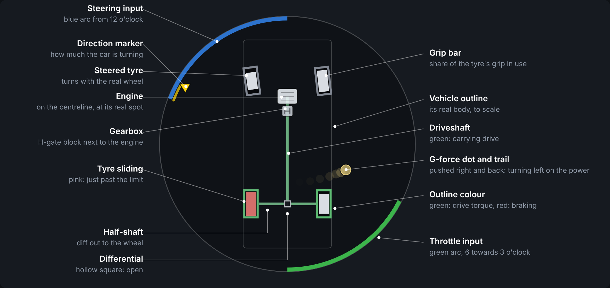

*Above: a front-engined, rear-drive car turning left on the power. The inside rear tyre has just gone past its limit (pink), the drive wheels have green outlines, and the G-force dot is pushed right and slightly back. The steering runs just past the yellow direction marker: the front is near its limit, slipping 1.7° more than the rear, as the balance at the top says. The key underneath explains each state the marker and the balance can show.*

## Contents

**Getting started**
- [What it is, and why](#what-it-is-and-why)
- [Highlights](#highlights)
- [Install](#install)
- [Your first drive: a ten-minute tour](#your-first-drive-a-ten-minute-tour)

**Reading the display**
- [At a glance](#at-a-glance)
- [The tyres](#the-tyres)
- [Your inputs on the rim](#your-inputs-on-the-rim)
- [The G-force dot](#the-g-force-dot)
- [The direction marker: understeer and oversteer](#the-direction-marker-understeer-and-oversteer)
- [The balance at the top](#the-balance-at-the-top)
- [Driver assists: ABS, ESC and traction control](#driver-assists-abs-esc-and-traction-control)
- [The drivetrain](#the-drivetrain)
- [Vehicles, layout and scale](#vehicles-layout-and-scale)

**Using it to drive better**
- [How to practise with it](#how-to-practise-with-it)
- [The grip budget](#the-grip-budget)
- [Threshold braking](#threshold-braking)
- [Trail braking, and reading the G trail](#trail-braking-and-reading-the-g-trail)
- [Steering with throttle or brake: why the line widens or tightens](#steering-with-throttle-or-brake-why-the-line-widens-or-tightens)
- [Finding the limit in a steady corner](#finding-the-limit-in-a-steady-corner)
- [Curing understeer](#curing-understeer)
- [Power oversteer: catching a slide](#power-oversteer-catching-a-slide)
- [Lift-off oversteer](#lift-off-oversteer)
- [Drifting](#drifting)
- [All-wheel-drive powerslides](#all-wheel-drive-powerslides)
- [Launches and traction](#launches-and-traction)
- [Load transfer and rollover](#load-transfer-and-rollover)
- [Kerbs, crests and jumps](#kerbs-crests-and-jumps)
- [Surfaces](#surfaces)
- [Differentials](#differentials)
- [Learning from the assists](#learning-from-the-assists)
- [Setting up a car with it](#setting-up-a-car-with-it)
- [More things it's good for](#more-things-its-good-for)
- [Common mistakes, and how they look](#common-mistakes-and-how-they-look)

**How it measures**
- [The parts of the mod](#the-parts-of-the-mod)
- [The grip bar](#the-grip-bar)
- [Sliding and slip ratio](#sliding-and-slip-ratio)
- [The G-force measurement](#the-g-force-measurement)
- [Direction of travel](#direction-of-travel)
- [How near each end is to its limit](#how-near-each-end-is-to-its-limit)
- [Drift and powerslide detection](#drift-and-powerslide-detection)
- [The marker's smoothing](#the-markers-smoothing)
- [How the assists are read](#how-the-assists-are-read)
- [How the drivetrain is drawn](#how-the-drivetrain-is-drawn)
- [Performance and latency](#performance-and-latency)

**Reference**
- [Settings you can change](#settings-you-can-change)
- [Console commands](#console-commands)
- [Calibrating grip](#calibrating-grip)
- [Compatibility](#compatibility)
- [Troubleshooting](#troubleshooting)
- [Questions and answers](#questions-and-answers)
- [Known limits](#known-limits)
- [Glossary](#glossary)

**About the project**
- [How it was tested](#how-it-was-tested)
- [Changelog](#changelog)
- [About the images](#about-the-images)

---

# Getting started

## What it is, and why

In a real car you feel the limit long before you see it, and much of that feel comes through the seat of your pants. The G-forces push you into the seat, the belts and the side bolsters. They tell you how hard the car is braking, accelerating and cornering, and where its weight is going: onto the nose under braking, onto the outside wheels in a corner. When they stop building as you add steering, the front has given up. When they suddenly swing, the rear is stepping out. The steering adds the rest: it goes light when the front tyres start to slide.

A simulator loses most of this. A force-feedback wheel can give back some of the steering feel, but without a motion rig nothing presses you into the seat, so the G-forces, the biggest part, are gone entirely. With a pad or keyboard, almost everything is.

Enthusia Professional Racing (2005) answered that with the VGS, a small diagram of the car that showed the weight moving and the tyres working. This mod brings the idea to BeamNG.drive, which has a full soft-body physics model with real tyres, so there is a great deal to show:

- **The G-forces you'd feel in the seat**: how hard the car is braking, accelerating and cornering, where the weight is moving, and wheels going light or leaving the ground.
- **How hard each tyre is working**, and the moment it goes past its limit.
- **How badly it's sliding**, from "just over" (pink, ease off now) to locked or spinning (deep red).
- **Which end of the car is giving up**: a warning before the front runs wide or the rear lets go, then understeer, oversteer, a held drift or a powerslide, with how many degrees it's out by.
- **Where the car is really going** against where you're steering, so you know where to point the wheels to catch a slide.
- **What the car is doing for you**: ABS, ESC and traction control, wheel by wheel, and the drivetrain, live.

It's a tool for learning to drive at the limit (threshold braking, trail braking, catching slides, balancing a car on the throttle), for understanding and setting up a car, and for checking that a vehicle does what you think it does. See [Using it to drive better](#using-it-to-drive-better).

## Highlights

- **Every wheel, to scale.** Grip in use, slides graded from "just over the limit" to "locked", drive and braking torque, live steering angle, flats and broken wheels. Cars, trucks with tandems and duals, three-wheelers, buses, tractor-trailers and articulated rigs.
- **Understeer and oversteer you can see.** A direction marker by the steering arc shows how much the car is really turning, and how near each end is to its limit, judged against the car's own tyres: BeamNG's stability-control calibration where the car has one, learnt while you drive where it doesn't. It warns in yellow before the front runs wide or the rear lets go, turns orange-red in real understeer, and swings out to the countersteer target in pink-magenta when the rear slides. A drift you're holding in control turns aquamarine instead. A band shows the gap to your steering, and each colour is held long enough to read. It's readable at highway and track speeds too.
- **The G-forces you'd feel.** A G-force dot with a fading trail shows what the seat of your pants would tell you: braking, accelerating and cornering forces and where the weight is moving. Measured from the physics, it follows a turn-in within about 35 ms and stays steady over a rough road.
- **The balance in words and degrees.** Whenever the car is off balance, the top of the circle says so: *Front near limit*, *Rear near limit*, *At the limit*, *Understeer* or *Oversteer* with how many degrees it's out by, *Drift* with the drift angle, or *Powerslide* with how far the rear is sliding.
- **Driver assists.** ABS, ESC and traction control per wheel and per engine, for both BeamNG's classic assist script and its newer driving-dynamics electronics.
- **The drivetrain, live.** Engines, motors, gearbox and differentials where they sit, shafts tinted by torque, diff lock state, disconnectable shafts, part-time 4WD, broken driveshafts.
- **Low latency.** Each vehicle sends its data straight to the app, exactly once per UI frame, using the same handshake BeamNG's own gauges use. The app draws once per screen refresh, carrying moving parts on smoothly between updates. In the simulation, through a slalom, the marker, the G-force dot and the grip bars trail the physics by 10 ms or less.
- **Tested against the physics.** Version 1.0 was checked frame by frame against a full four-wheel vehicle simulation: 35 vehicles (front, rear and all-wheel drive, nose- and tail-heavy, trucks, slicks to all-terrain tyres) through 27 manoeuvres each, from gentle cornering to spins. See [How it was tested](#how-it-was-tested).

## Install

1. Put `vgs_display.zip` in your BeamNG `mods` folder. Unzipped works too.
2. Start the game and load a vehicle.
3. Open the UI app selector and add **VGS Display**. It's in the **Telemetry** category.
4. Move and resize it to taste:
   - The circle always fills the app, so a bigger app means a bigger diagram. The default is 240 × 240 pixels, and the smallest is 120 × 120.
   - Long rigs (trucks with trailers, buses) benefit from a bigger app.
   - For learning, a big app near the middle of your view (around 350–450 pixels, just below the horizon) is easiest to read without taking your eyes off the road for long. Once you know it, a smaller one in a corner is enough to catch colours out of the corner of your eye.
   - You can add the app more than once, say a small one and a large one.

Nothing else is needed. The app loads its own game-engine script when it opens and stops it when it closes. It starts the per-vehicle script on whatever you're driving and anything coupled to it, and stops it on vehicles you leave.

To update, replace the zip and restart the game (or reload the UI and vehicle Lua). To remove it, delete the zip (or its folder) from `mods`.

## Your first drive: a ten-minute tour

The quickest way to learn the display is to make it show each of its states once, on purpose. Any ordinary rear-drive road car on a large open stretch of tarmac will do.

1. **Let it learn the car.** Drive a few gentle bends or weave lightly for ten seconds or so. Cars with BeamNG's driving-dynamics or classic ESC calibration don't need this; for others, the understeer and oversteer warnings use fixed slip angles until they've seen some gentle cornering (see [How near each end is to its limit](#how-near-each-end-is-to-its-limit)).
2. **Watch the inputs.** Steer, brake, accelerate: blue arc from the top, red from the bottom towards the left, green from the bottom towards the right. The yellow dot moves forward under braking, back under power, and across in a turn.
3. **Brake hard in a straight line** from about 80 km/h. The front grip bars fill; if the car has ABS, the brake arc pulses and small red dots flicker by the wheels. Without ABS, push until a front tyre turns pink, then red: that's a lock-up.
4. **Corner faster and faster** on a steady circle. The bars grow, then a yellow marker appears by the steering arc: *Front near limit* (or *Rear near limit* in a tail-happy car). Add more steering and it turns orange-red: *Understeer*. Unwind the steering to the marker and it clears.
5. **Add throttle mid-corner** in second gear. The rear bars fill, turn pink, the marker swings out to the right in pink-magenta: *Oversteer*. Steer towards the marker (opposite lock) and ease the throttle until it holds steady; it turns aquamarine: *Drift*, with the drift angle on top.
6. **Launch hard from a stop.** The rear tyres go pink or red as they spin. Find the throttle where they just stay white or pale pink: that's the fastest start.
7. **Drive over a kerb or a crest.** A wheel that leaves the ground turns blue; one that's nearly off it turns pale blue.

Each of these is explained, with pictures, in [Using it to drive better](#using-it-to-drive-better).

---

# Reading the display

## At a glance

| You see | It means |
|---|---|
| White bar growing out from the middle of a tyre | That tyre is working: the taller the bar, the more of its grip is in use |
| A tyre filled solid pink | It's just past its limit. Ease off now and it comes back |
| A tyre filled solid deep red | It's well past the limit: sliding, locked or spinning |
| A tyre turning pale blue | It's nearly off the ground: carrying little of its normal load |
| A tyre filled blue | It's off the ground |
| Green outline on a tyre | Drive torque is going through it |
| Red outline on a tyre | It's being braked (brakes, engine braking or regen) |
| Dashed outline | A flat tyre (bar kept), or a broken-off wheel (no bar) |
| Blue arc from the top of the rim | Steering input |
| Wedge just inside the steering arc (only when the car is off balance) | How much the car is actually turning, as a steering angle, with a band in its colour back to the end of the steering arc. Yellow: a warning, one or both ends nearing their limit; orange-red with the steering well past it: understeer. Once the rear slides it swings out to where the front is going, the countersteer target: pink-magenta while the slide is getting away, aquamarine once you've caught it in a controlled drift or are holding an all-wheel-drive powerslide |
| Degrees and a word at the top of the circle | The balance: which end is near or past its limit and by how many degrees, or a drift's angle |
| Red arc from the bottom, towards the left | Brake pedal |
| Green arc from the bottom, towards the right | Throttle pedal |
| Thin white arc along the edge, over the throttle | Clutch pedal |
| Thin wine-red arc along the edge, over the brake | Handbrake |
| Yellow dot and trail | The G-force you feel, and where it's been for the last 1.3 s |
| Brake arc pulsing | ABS is working |
| Throttle arc pulsing darker | An assist is cutting power: traction control, or ESC working through the engine |
| Small red dot beside a wheel | ABS is acting on that wheel |
| Small blue dot beside a wheel | ESC is braking that wheel |
| Small green dot in the middle of the engine or motor | Classic traction control is intervening on the wheels it drives: braking a spinning wheel, or cutting its power |
| Small green dot beside a wheel | Traction control is acting on that wheel (newer driving-dynamics cars): braking it, or cutting the power of the motor that drives it |
| Green driveshaft | The engine is driving the wheels at the end of it |
| Solid or hollow diamond on a shaft | A shaft you can disconnect (part-time 4WD, locking hubs): connected or disconnected |

The marker, its band and the words at the top only appear when the car is off balance. A clear rim with no marker means all's well.

## The tyres

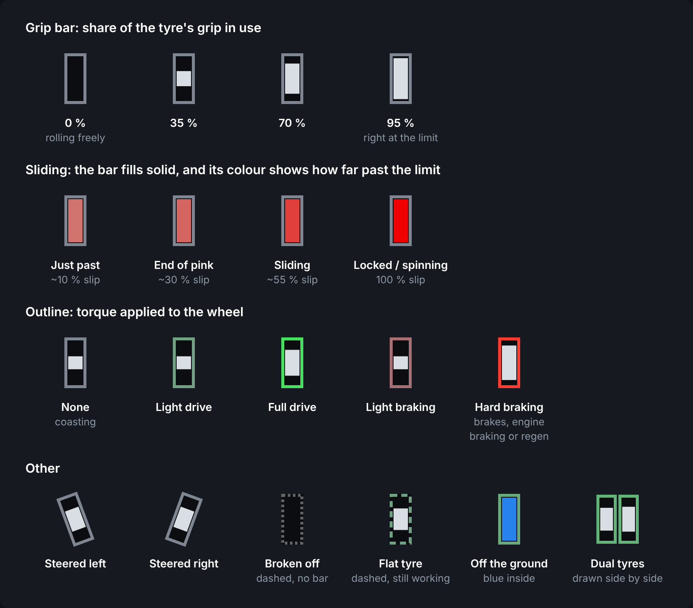

| Part of the wheel | Meaning |
|---|---|
| Inner bar, growing from the centre | Share of the tyre's grip in use, 0 to 100 % |
| Inner bar filled solid, pink to deep red | Grip limit exceeded (tyre sliding). It stays a greyish pink while the tyre is still near its peak grip (up to about 30 % slip), then deepens to saturated red towards a full lock-up or spin |
| Outline grey → green | Drive torque applied |
| Outline grey → red | Braking torque applied (brakes, engine braking, regen) |
| Rotation | Live steering angle of that wheel |
| Dashed outline, no bar | Wheel broken off |
| Dashed outline, bar and colour kept | Flat or punctured tyre |
| Turning pale blue | Nearly off the ground: the paler, the less load it's carrying (from a quarter of its normal load down to none) |
| Filled blue | Off the ground: carrying no load |
| Small red dot beside it | ABS is acting on that wheel |
| Small blue dot beside it | ESC is braking that wheel |
| Small green dot beside it | Traction control is acting on that wheel (driving-dynamics cars) |

### Grip bar

The white bar grows from the middle of the tyre towards both ends. An empty tyre is rolling freely, and a full bar is right at the limit. It counts everything the tyre is doing at once: cornering, braking and driving together (see [The grip budget](#the-grip-budget)).

BeamNG doesn't report a "friction used" figure per tyre, so the bar is an estimate: the force the tyre is making against the force it can grip with. Each axle's grip is learnt while you drive, so race slicks, all-terrain tyres and loose surfaces read right once the car has been near its limit. How it's worked out: [The grip bar](#the-grip-bar).

### Sliding, and how far past the limit

When a tyre slides, its bar fills the whole tyre, and its colour shows how far past the limit it is:

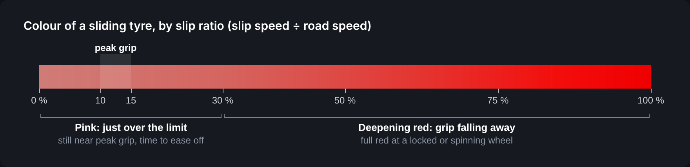

The colour comes from the **slip ratio**: how fast the tyre is sliding compared with how fast the car is going. 10 % means the tyre surface is moving 10 % faster or slower than the road under it; 100 % means a locked wheel, or one spinning as fast again as the road. The scale follows how real road tyres behave:

- **Peak grip is at about 10–15 % slip.** This is where threshold braking and a good launch live.
- **Up to about 30 % slip, the tyre is still within a few percent of its best grip.** The display keeps it pink through this band. It's the warning that you're just over the limit, with time to ease off before grip really goes.
- **From 30 % to 100 %, grip falls away** towards a locked or spinning wheel's sliding grip. The red deepens steadily and is fully saturated at 100 %.

So **pale pink is fine, even ideal, for a moment; deep red is always lost time**. Some examples at 90 km/h:

| Slip speed | Slip ratio | Shown as |
|---|---|---|
| 3 m/s | 12 % | Pale pink: ideal threshold braking |
| 7.5 m/s | 30 % | Pink, at the end of the pink band |
| 12 m/s | 48 % | Clear red |
| 25 m/s | 100 % | Deepest red: locked |

Details: [Sliding and slip ratio](#sliding-and-slip-ratio).

### Outline: torque

The outline shows the torque going through the wheel as a share of what that tyre can take. It goes from grey, through softer tints, to full green for drive or full red for braking.

- **Green:** drive torque from the engine or motor, while you're on the throttle.
- **Red:** braking torque. This includes the friction brakes, engine braking and regenerative braking. Off the throttle, any torque from the drivetrain counts as braking.

### Steering, broken, flat and airborne wheels

- **Steering:** each tyre turns with its real steering angle, measured from the hub's axle. Straight ahead is taken when the vehicle spawns with the steering centred, so static toe reads as straight ahead. If the steering wasn't centred then, it's taken the first time it is. Rear-steer, four-wheel steering scripts and multi-axle steering show up the same way.
- **Broken off:** the outline goes grey and dashed, and the bar disappears.
- **Flat or punctured:** the outline turns dashed but keeps its torque colour and grip bar, since the wheel still rolls and drives (BeamNG's `isTireDeflated` and `isPunctured`).
- **Nearly off the ground:** as a wheel's load falls below a quarter of its normal load (`LIGHT_FRAC`), its inside turns pale blue, a lighter shade of the off-the-ground blue, growing stronger until it's solid pale blue just before the wheel lifts. That's an inside wheel in a hard corner, a car about to go up on two wheels, or a wheel at the top of a crest. The load is smoothed a little (`LIGHT_HZ`), so a bump gives at most a faint tint. The normal load is followed slowly while the wheel is properly loaded (`LIGHT_REF_TAU`), so it adapts to the vehicle and its payload.
- **Off the ground:** a wheel carrying less than 150 N (`MIN_LOAD`) has no grip and can't count as sliding. It's *shown* off the ground only once it has carried that little for a quarter of a second (`AIR_SHOW_AFTER`): on a rough road a wheel is unloaded for a frame or a few on every bump without really leaving the ground, and that shouldn't turn it blue. Until then, and through every bump, the grip bar and slide colour hold what they showed rather than dropping to nothing. Then its inside turns a strong blue (clearly different from the white grip bar and the pink and red of a slide), and its outline still shows any torque (a drive wheel spinning in the air). It's back on the ground as soon as it carries twice that load, so a wheel skimming the road doesn't flicker. A wheel lifting gradually goes white (or red, sliding), pale blue, then blue, with no gap in between.

## Your inputs on the rim

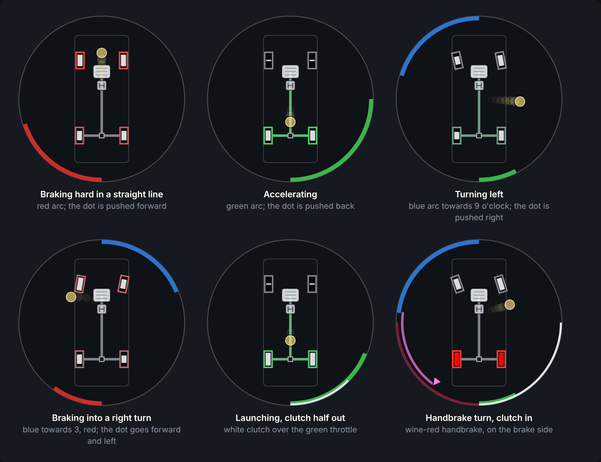

Around the rim of the circle are your inputs, each filling up to a quarter turn at full input:

| Arc | Meaning |
|---|---|
| Blue, from 12 o'clock | Steering: grows towards 9 o'clock turning left, towards 3 o'clock turning right; a full quarter at full lock. The scale is stretched around the centre, so the few degrees you steer at speed are easy to read (see below). The small corrections of driving straight don't show: the arc fades in between about 0.55 % and 1.2 % of steering in town (2.7° to 6° of rim), and between about 0.25 % and 0.55 % from about 80 km/h up, where the stretched scale would otherwise make the smallest jitter visible (`STEER_HIDE_DEG`, `STEER_SHOW_DEG`, `STEER_VIS_K` in `app.js`). So the rim stays clean on a straight at any speed |
| Wedge just inside the steering arc | How much the car is turning, on the same scale as the steering; see [The direction marker](#the-direction-marker-understeer-and-oversteer) |
| Red, from 6 o'clock towards 9 | Brake pedal |
| Green, from 6 o'clock towards 3 | Throttle pedal |
| White, from 6 o'clock towards 3, half as wide along the outer edge | Clutch pedal (a full quarter with the pedal fully down), drawn over the throttle |
| Wine red, from 6 o'clock towards 9, half as wide along the outer edge | Handbrake, drawn over the brake |

The clutch and handbrake arcs are half as wide as the others and run along the outer edge of the rim, so the throttle and brake underneath stay visible.

### What the pedal arcs show exactly

Steering is read the same way as BeamNG's own Steering app, from `steering_input` (negative to the left). The pedals are read exactly the way BeamNG's Simple Pedals app reads them: the applied `throttle`, `brake`, `clutch` and `parkingbrake` values, turned into whole percent with the same rounding. That rounding only shows 0 % for exactly zero and 100 % for exactly full: a pedal that's barely touched shows at least 1 %, and one that doesn't quite reach the end stops at 99 %. That makes a controller deadzone, or a pedal that never fully releases, visible as a sliver of arc.

These are the values actually applied, not only what you press: `brake` includes the automatic brake hold, so the red arc can show a little while stopped with your foot off the pedal, and on a car with an automatic clutch the white arc shows the clutch working by itself. Nothing is drawn when an input is at rest.

### The steering scale

At track and highway speeds the road wheels only turn a degree or a few, which on a straight scale would be a sliver of rim, with the direction marker almost at 12 o'clock. So the steering arc and the marker share a scale that's stretched around the centre and compressed towards full lock (`asinh(k·x) / asinh(k)`), and the stretch grows with speed.

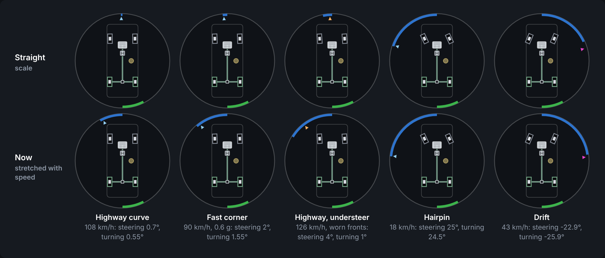

The vehicle script works out how much steering a 1 g corner needs at its current speed, from its own wheelbase (plus a little for normal tyre slip), and sets the stretch so that much steering fills 60 % of the quarter (`STEER_TARGET`). It sends the stretch to the app, so the marker's smoothing and the drawing use the same scale. Below about 55 km/h it stays at its low-speed minimum (`STEER_EXPAND`), and full lock is always exactly a quarter turn. For a typical car (2.7 m wheelbase, 31.5° full lock):

| Speed | Stretch | 0.5° of road-wheel angle | 1° | 2° | 4° | Half lock |
|---|---|---|---|---|---|---|
| Straight scale, any speed | none | 1° of rim | 3° | 6° | 11° | 45° |
| Up to 54 km/h | 20 | 8° | 15° | 26° | 41° | 73° |
| 72 km/h | 39 | 12° | 21° | 34° | 47° | 76° |
| 90 km/h | 79 | 19° | 29° | 41° | 53° | 78° |
| 108 km/h | 130 | 24° | 34° | 45° | 57° | 79° |
| 126 km/h | 185 | 27° | 38° | 48° | 59° | 79° |

Because both use the same scale, what matters is never the arc's length on its own, but **where the marker sits against the end of the arc**.

## The G-force dot

The **yellow dot** is the G-force you feel, from the vehicle you're driving:

- Braking pushes it **forward**, accelerating pushes it **back**.
- A left turn pushes it **right**, a right turn pushes it **left**.
- The edge of the circle is 1.5 g (`GF_MAX`). A road car's limit of about 1 g reaches two-thirds of the way out. Anything past 1.5 g is pinned to the edge.
- Where it's been over the last 1.3 s (`TRAIL_MS`) is drawn as a trail of fading copies. Copies that would sit on top of the dot, or on top of each other, are skipped, so the dot stays see-through when it's holding still.
- It's a little see-through (`GF_ALPHA`), so the part underneath still shows, with a firm rim and a thin dark ring around it so it stands out against the grip bars, the arcs and the car.

It's there to show the **weight shifting**, which you can't feel in a simulator: forward onto the front tyres under braking, back under power, across in a corner. It's measured from the change in the vehicle's velocity, so it reads zero when parked on a hill. It follows a turn-in about 35 ms behind the true force, and stays steady over a rough road. How: [The G-force measurement](#the-g-force-measurement).

Two habits make it useful:

- **The grip bars say how much of the grip you're using; the dot says how much grip there is.** On tarmac a road car reaches the limit with the dot about two-thirds of the way out; on snow, with the bars just as full, it barely leaves the middle. See [Surfaces](#surfaces).
- **The trail shows how smoothly you hand the grip from one job to another.** A dot that sweeps round near the edge from braking into cornering is using all the grip all the time; one that drops back to the middle between them is wasting it. See [Trail braking, and reading the G trail](#trail-braking-and-reading-the-g-trail).

## The direction marker: understeer and oversteer

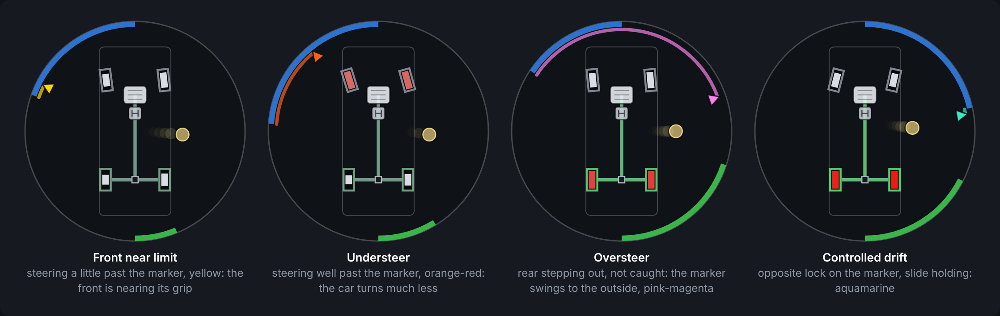

In a simulator you can't feel the car start to slide or the front start to push. So just inside the steering arc, on the same scale (a quarter turn is full lock, stretched around the centre), the **direction marker**, a wedge, shows how much the car is actually turning, as a steering angle:

- **While the rear tyres grip** (normal driving, and understeer), the marker sits at the steering that would make the car's current turn if neither end of the car slipped. It's always on the side the car is turning to, and the gap between it and the steering arc is the understeer: how much more you're steering than the car is turning.
- **Once the rear slides** (oversteer, a drift, a spin), the marker swings towards the outside of the turn, to where the front of the car is actually going. Steering at it points the front wheels exactly where they're travelling: the countersteer target. In a big drift it goes past a quarter turn, and all the way round in a spin.

**The rule of thumb: steer towards the marker.** In understeer, that means less steering; in oversteer, opposite lock.

| What you see | What's happening | What to do |
|---|---|---|
| No marker | The car is balanced: neither end is near its limit | Nothing: that's the sweet spot |
| **Yellow** marker, *Front near limit* | The front tyres are getting close to their grip limit, before the car actually runs wide | Don't add more steering or speed; this is the warning |
| **Yellow** marker, *Rear near limit* | The rear tyres are getting close to theirs: the car may be about to step out (lifting off, braking or more power now could tip it over) | Be smooth with the pedals and the steering |
| **Yellow** marker, *At the limit* | Both ends are near their limit together: the car is using all its grip | You're at the edge; any more and one end will go |
| Steering arc runs well past the marker, **orange-red** | The front tyres are past their grip and scrubbing: the car turns much less than you steer. **Understeer** | Ease off the steering back towards the marker; more lock won't turn the car |
| Marker beyond the steering arc, then swinging to the outside of the turn, **pink-magenta** | The rear is stepping out: the car is rotating more than you steer. **Oversteer** | Follow the marker with opposite lock |
| Marker out on the opposite-lock side, **aquamarine**, steering on it | You've caught the slide: the countersteer matches it and it's holding. **A controlled drift** | Keep balancing it with steering and throttle |
| **Aquamarine**, all-wheel drive, steering into the turn | All four tyres sliding under power, held. **A powerslide** | Keep the power on and steer the car round |

The marker only shows when the car is off balance; while it's neutral it's hidden, so a clear rim means all's well. Off balance, it's in one of these states, each in a strong colour so you can tell them apart at a glance. Yellow is always a warning (the words at the top say which end), the other colours are the car actually doing something:

| State | Colour |
|---|---|
| Front near limit (the understeer warning) | yellow |
| Rear near limit (the oversteer warning) | yellow |
| At the limit (both ends) | yellow |
| Understeer | orange-red |
| Oversteer | pink-magenta |
| Controlled drift | aquamarine |
| Powerslide (all-wheel drive) | aquamarine |

To make it easy to read at speed:

- **Distinct colours.** A few clear states, not a gradual blend. Before 2.4 the colour blended continuously from light blue, so when the marker appeared it was a pale mix and changed every frame. The colours were picked by simulation to stay distinct from each other and from the rim's arcs with the common kinds of colour blindness, and they differ in lightness as well as hue (yellow is the lightest, orange-red the darkest).
- **Held long enough to read.** Getting worse (a warning turning into understeer or oversteer, one end's warning becoming both), switching between understeer and oversteer, or losing a drift shows at once. Easing off (back to a warning, from one warning to another, or back to neutral) waits 0.45 s (`STATE_HOLD_MS`), so a quick flick of oversteer stays up long enough to see. Each state also has a little hysteresis at its edges. A slide has to stay caught for 0.2 s (`DRIFT_CONFIRM_MS`) before it turns aquamarine, so the start of a slide never flashes "in control". On the captured cornering run, the colour used to change 15 times in 3.4 s, 14 of them for under 0.2 s; now it changes once.
- **Bigger.** The marker is about a fifth bigger than before 2.4, with a dark edge, so it stands out against the steering arc and the dark circle.
- **The gap is drawn.** A band in the marker's colour runs between the marker and the end of the steering arc: how far you're steering past where the car is going (understeer), or short of it (oversteer). Its length is the size of the problem.

It fades in within a few frames and out over about a tenth of a second. The balance at the top of the circle always shows the same state as the marker.

**When it shows:** whenever the vehicle is moving, including sliding backwards in a spin. It fades in between 0.5 and 1.5 m/s (2–5 km/h, `TRAVEL_FADE_LO`, `TRAVEL_FADE_HI`), and it's hidden when you're reversing on purpose, in reverse gear. Straight-line driving stays clear: the states need the car to be rotating, and at a crawl (both axles under about 1.5–3 m/s) nothing shows, though a donut, where the rear is moving fast, still counts.

How the marker and the states are worked out: [Direction of travel](#direction-of-travel), [How near each end is to its limit](#how-near-each-end-is-to-its-limit) and [Drift and powerslide detection](#drift-and-powerslide-detection).

## The balance at the top

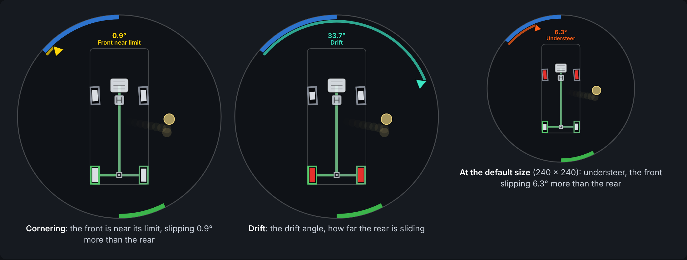

At the top of the circle, in the direction marker's colour, the balance on two lines: in large figures, how many degrees more one axle is slipping than the other, and under it the verdict in words. Both lines stay at fixed heights. While the car is balanced nothing shows there. Otherwise the words follow the marker:

| Words | Colour | Degrees |
|---|---|---|
| *Front near limit* | yellow | how much more the front is slipping than the rear |
| *Rear near limit* | yellow | how much more the rear is slipping than the front |
| *At the limit* | yellow | the difference between front and rear slip |
| *Understeer* | orange | the same, once the front is clearly past its grip |
| *Oversteer* | pink-magenta | how much more the rear is slipping than the front |
| *Powerslide* | aquamarine | how far the rear is sliding |
| *Drift* (a controlled drift) | aquamarine | the drift angle: how far the rear is sliding, as on the AC version and Drift Scoring's angle meter |

In an app smaller than about 125 pixels the words are shortened (*Under*, *Front near*, *Rear near*, *At limit*, *Over*, *Drift*, *Powerslide*).

Degrees that change every frame can't be read, so they're averaged over a short window and refreshed about seven times a second (`READ_MS`). The drawing itself still shows every update as it arrives. The vehicle is drawn just small enough to stay clear of the band at the top.

The vehicle only works out the values behind the degrees (the two axles' slip angles, a powerslide's slide and a drift's angle) while the app is open, so it costs nothing the rest of the time.

## Driver assists: ABS, ESC and traction control

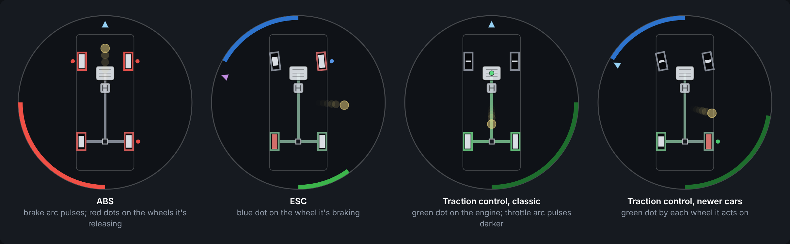

| Assist | Shown as |
|---|---|
| ABS | The brake arc pulses, and a small red dot sits beside each wheel ABS is acting on |
| ESC | A small blue dot sits beside each wheel ESC is braking |
| Traction control | A small green dot: on the engine for the classic script, beside each wheel it acts on for driving-dynamics cars. The throttle arc pulses darker too |
| ESC cutting power | The throttle arc pulses darker too. Newer cars' ESC often works through the engine as well as the brakes |

Everything is read straight from what the vehicle reports, and nothing is held or averaged (except a traction-control wheel dot, which stays 0.3 s after each pulse of the brake): each update shows that moment, so the dots flicker as fast as ABS pulses. Nothing shows for an assist the vehicle doesn't report having (`hasABS`, `hasTCS`, `hasESC`).

A dual set shares one dot per corner. If more than one assist acts on the same corner, ESC's blue dot shows first, then traction control's green, then ABS's red. The pulse runs at 5 per second (`PULSE_HZ`).

Two kinds of assist system are covered: the classic ESC script most vehicles use, and BeamNG's newer driving-dynamics electronics (the Vivace, for one). How each is read: [How the assists are read](#how-the-assists-are-read). What they can teach you: [Learning from the assists](#learning-from-the-assists).

## The drivetrain

Underneath the wheels is the drivetrain. It's read the same way as BeamNG's PowerTrain debug app: each engine or motor is followed through the powertrain devices to the wheels it drives. Engines, motors, the gearbox and the differentials are drawn where they sit, and the shafts between them are tinted by the torque they carry. Shafts that can be disconnected are marked with a diamond.

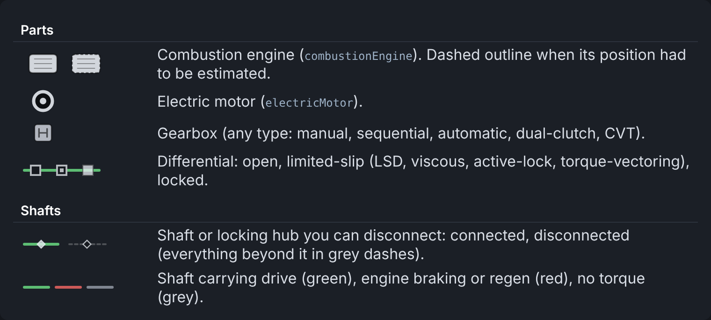

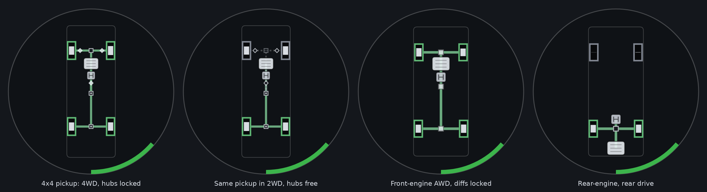

### Parts

| BeamNG device | Drawn as | Notes |
|---|---|---|
| `combustionEngine` | Light block with ribs | On the centreline at its fore/aft position. Dashed outline when its position had to be estimated. |
| `electricMotor` | Ring with a centre dot | A motor that drives the wheels on one side only (e.g. each rear motor of a tri-motor car) keeps its side position. |
| Gearbox (`manualGearbox`, `sequentialGearbox`, `automaticGearbox`, `dctGearbox`, `cvtGearbox`) | Small block with an H-gate | The first gearbox on the way from the engine to the wheels. |
| `differential`, `splitShaft` | Small square | Fill shows its type and lock state; see the next table. Axle diffs sit at the middle of their axle, with half-shafts out to the wheels; centre diffs and transfer cases sit on the centreline between the gearbox and the axles. |

Only engines and motors that drive wheels are drawn, so motors for hydraulics, winches or trailer landing gear don't show up. Modded engines, motors and gearboxes are recognised the same way, by their device category or by a type name ending in `Engine`, `Motor` or `Gearbox`. A motor fitted partway down an engine's driveline, as in some hybrids, is drawn in line, fed by that engine.

### Differentials

| Differential | Drawn as |
|---|---|
| open, torqueVectoring | Hollow square. Also used when the diff has no type, as that's BeamNG's default. A torque-vectoring diff splits torque like an open one in BeamNG's differential code |
| lsd, viscous | Hollow square with a centre block |
| activeLock (an electronically clamped diff) | Shown live from how hard the car's electronics clamp it (`activeLockCoef`): hollow below 5 %, centre block in between, solid from 95 % |
| locked (spool or welded) | Solid square |
| Any type switched to mode `locked` (a selectable locker you've engaged) | Solid square; switching back updates live |
| Transfer case (`splitShaft`) | Solid when its `splitType` is `locked`, centre block when `viscous` |
| dually | Not drawn: it joins the two tyres of a dual pair, so it's part of the wheel |

A diff cut off from the engine by a disconnected shaft is drawn faded. Differentials are drawn on top of engines and gearboxes, so a transaxle's diff stays visible.

### Disconnectable shafts

Only shafts you can actually disconnect and reconnect get a marker: a part-time 4WD's front driveshaft, locking hubs and axle disconnects.

| State | Drawn as |
|---|---|
| Connected | Solid diamond on the shaft |
| Disconnected | Hollow diamond. Everything beyond it is drawn as grey dashes, and those wheels count as undriven |

### Shafts

| Looks like | Meaning |
|---|---|
| Solid, grey → green | Carrying drive to the wheels it feeds. An on-demand AWD's rear driveshaft stays grey until the coupling starts sending torque back, then turns green |
| Solid, grey → red | Engine braking or regen |
| Grey dashes | Disconnected right now, broken, or beyond a disconnected or broken shaft (those wheels count as undriven) |

The shaft colour is the drive or braking torque reaching the wheels that shaft feeds, as a share of what the tyres can take. Friction brakes don't tint shafts.

How parts are found, placed and spread out: [How the drivetrain is drawn](#how-the-drivetrain-is-drawn).

## Vehicles, layout and scale

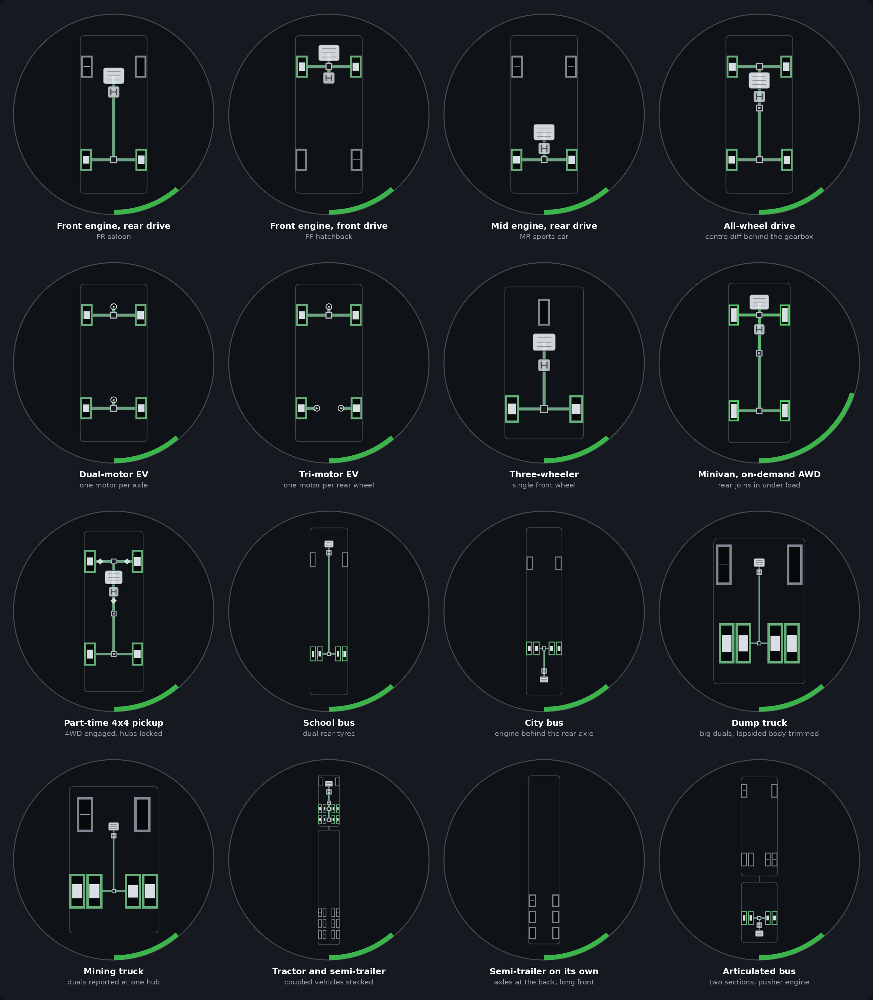

Everything is drawn to scale, from measurements taken when the vehicle spawns:

- **Wheels** sit at their real positions, including any `wheelOffset`. Each tyre is drawn at its real diameter and at 1.5 times its real width so it's easy to see (`TYRE_WIDEN`). A wheel with no tyre, such as the Ibishu Pigeon's stabiliser wheels, is drawn at the size of its hub. Very small wheels are kept at least a few pixels across.
- **The outline** is the vehicle's real body: the extent of all its nodes, seen from above. It's kept symmetric about the middle of the axles. Anything that sticks out on one side only, such as a haul truck's left mirror and railing, a ladder or an exhaust stack, is trimmed back to match the other side, so the wheels stay centred. Front and rear overhangs are kept as they are.
- **The circle** is always the same size: it fills the app. The vehicle is scaled to fit inside it, clear of the input arcs and the balance band at the top, with room for its tyres at full steering lock.
- **Coupled vehicles** (trailers, dollies, separately spawned bus sections) are drawn as separate outlined boxes stacked front to back, all at the same scale, shrunk to fit inside the circle. They're found from BeamNG's own record of each vehicle's attached couplers, its trailer register and its coupler events, so a trailer hitched before you opened the app shows straight away. A coupled vehicle that stops sending data (deleted, or out of range) is dropped after 1.5 s. Coupled vehicles show their wheels, slides and assists; the marker and the balance words are for the vehicle you're driving.
- **A trailer** with its axles at the back shows its long empty front section, whether you're driving the tractor or have switched to the trailer itself.

### Dual tyres

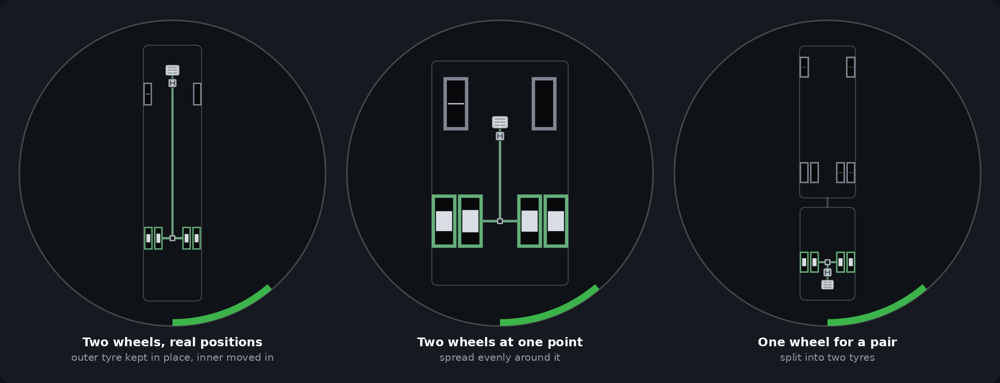

Dual tyres draw side by side with a small gap. BeamNG vehicles report them in three different ways, and each is handled:

- **Two wheels at their real positions.** These are wheels on the same side of an axle that are within 0.6 m of each other (`DUAL_GAP`), or close enough that their widened tyres would touch. It includes duals that share one hub and are pushed apart by `wheelOffset`, as on the school bus and the dump truck. If the widened tyres would overlap, the outer tyre stays at its real position and the inner one moves inwards. That way the outer edge lines up with the other axles as it does on the real vehicle: a school bus's front wheels sit in line with the outer duals, while a semi tractor's sit between the two.
- **Two wheels at the same point.** Duals reported at a single hub position (within 5 cm, `DUAL_SAME_HUB`) are spread evenly around that point.
- **One wheel standing in for a pair.** It's detected from a dual flag, a tyre mesh named "dual", or a truck-sized tyre (radius at least 0.42 m) that's wider than its radius (`DUAL_WIDTH_RATIO`). This also covers BeamNG's simplified duallies setting. The wheel is drawn as two tyres, spread evenly around its position, both showing the same data.

---

# Using it to drive better

Every driving skill that matters at the limit comes down to one question: **how much of each tyre's grip am I using, and for what?** In a real car you answer it through the G-forces in the seat and the feel of the steering. Here you can see it. This part goes through the classic skills one by one, with what each looks like on the display, what to do, and what going wrong looks like.

The pictures are drawn by the mod's own renderer. Each strip reads left to right through one manoeuvre, or side by side as alternatives. The yellow trail behind the G-force dot shows where it's been over the last moment.

## How to practise with it

- **One thing at a time.** Pick one lesson below and repeat it until the display does what you want, before moving on.
- **Use a big, empty space.** A large flat car park, an airfield or a test track, where running wide costs nothing. Practise each skill in both directions.
- **Start with an ordinary road car.** A mid-size rear-drive saloon or coupé on road tyres, with the assists you'd normally use. Its limits come slowly and loudly. Race cars and slicks reach them faster and more abruptly.
- **Make the app big while learning** (350–450 pixels, low in the middle of your view), so you can read it with a glance rather than a stare. Shrink it later.
- **Use BeamNG's slow motion and pause.** Slowing the simulation down gives you time to see the sequence: the bars fill, a tyre goes pink, the marker appears, then the car moves. Pausing freezes the display on that moment, with every reading still on screen.
- **Look at the order of events, not just the end.** Almost every mistake shows up a fraction of a second before the car does anything: a bar filling, pale blue on an inside wheel, a yellow marker. Learning to react to those is the point.
- **Let it learn the car first.** A car without BeamNG's stiffness calibration needs a few gentle bends before its warnings are tuned to its tyres, and the grip bars learn each axle's grip once you've been near its limit. Spend the first minute driving gently, then once or twice near the limit.

## The grip budget

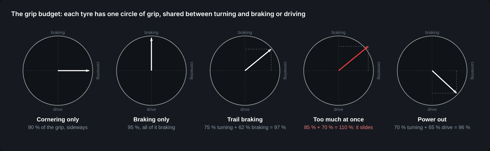

A tyre can only make so much force, and it's the same budget whether that force turns the car, brakes it or drives it. Engineers draw it as the **friction circle** (or traction circle): the arrow can point any way, but it can't go past the edge. Use 90 % of the grip to corner, and only a sliver is left for braking; brake at 95 %, and there's almost nothing for steering.

Combining is fine, and fast, as long as the total stays inside the circle: 75 % turning and 62 % braking is about 97 %, because the two add like the sides of a right-angled triangle, not straight. Push both too far and the arrow leaves the circle: the tyre slides.

**On the display**, each tyre's grip bar is that arrow's length: everything the tyre is doing, sideways and forwards together. A full bar means the arrow is at the edge, whatever it's being used for. The G-force dot shows the same thing for the car as a whole: its distance from the middle is the total force, its direction is what the force is for. That's why a good lap draws a G trail that hugs the edge of a circle (see [Trail braking, and reading the G trail](#trail-braking-and-reading-the-g-trail)).

Two things decide how big each tyre's circle is:

- **Load.** A tyre pressed harder into the road grips harder (a little less than in proportion). Braking moves load onto the front tyres and off the rear; accelerating does the opposite; cornering moves it onto the outside tyres. The G-force dot shows which way it's going; pale-blue wheels show where it's gone from.
- **The surface and the tyre.** Snow shrinks everyone's circle; slicks grow it. The grip bars always show the share of the circle in use; how big the circle is, you read from how far out the G-force dot can get (see [Surfaces](#surfaces)).

Nearly everything below is this one idea applied to a different situation.

## Threshold braking

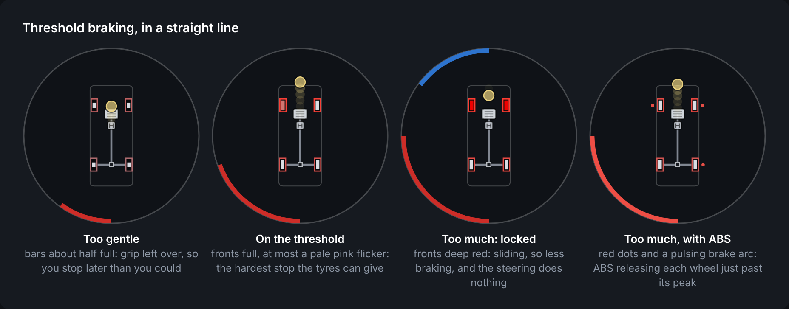

**The skill:** braking as hard as the tyres allow, right at the point where any more would lock them. A rolling tyre at 10–15 % slip brakes harder than a sliding one, so the fastest stop is just short of a lock-up, not in one.

**What to look for:**
- **Too gentle:** the front bars well short of full, the G-force dot well short of where it could be. You're stopping later than you could.
- **On the threshold:** the front bars full, with at most a pale pink flicker. The G-force dot is as far forward as it gets (around 1 g for a road car on tarmac). The rear bars are usually a bit lower: braking takes load off the rear, and the brakes are biased forward to match.
- **Too much:** a front tyre turns pink, then deep red. A locked tyre brakes less than one at the threshold, so the dot moves back towards the middle as you press harder. And a locked front tyre can't steer: you can see the steering arc grow while the car carries straight on.
- **With ABS:** the brake arc pulses and red dots flicker by the wheels ABS is releasing. ABS is holding them near the threshold for you.

**How to practise:**
1. From 80–100 km/h, brake progressively and squeeze until the front bars fill.
2. Hold the pedal where they're full but not red. If one goes pink, ease off a touch until it's white again.
3. Brake hard at first, then ease the pedal as you slow. The car's downforce (if it has any) and the load on the nose change as speed falls, and a tyre that was at the threshold at 100 km/h locks at 30.
4. Try it with ABS off (on cars where you can switch it in the vehicle's parts or tuning) and compare: if your stop is as short as ABS's, with pale pink at most, you've got it.

**Common mistakes:**
- **Stabbing the pedal.** The fronts jump straight to deep red. Squeeze instead: the load has to move onto the front tyres before they can take full braking, which takes a fraction of a second (the G-force dot moving forward is that load arriving).
- **Locking the rear first.** A rear tyre turning red under braking means too much rear brake bias, or braking while turning on a light rear. A car with locked rears wants to spin.
- **Braking over bumps or crests:** a wheel that goes light locks at once (pale blue, then deep red). Ease off over the bump.
- **Relying on ABS to steer while braking hard.** ABS keeps the tyres steerable, but every bit of grip used to brake is gone from steering. Watch the front bars: if they're full from braking, there's nothing left to turn with.

## Trail braking, and reading the G trail

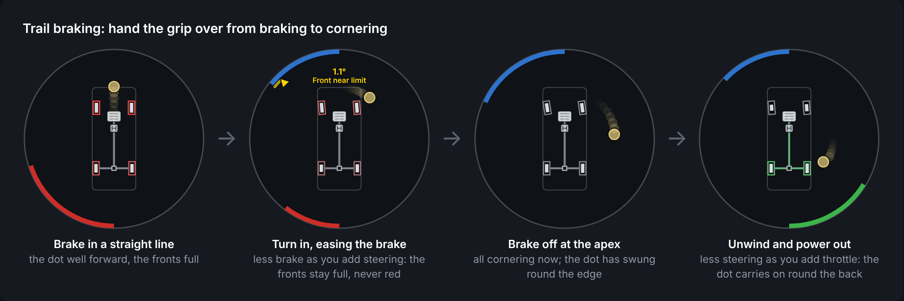

**The skill:** carrying some braking into the corner and easing it off as you add steering, so the tyres hand their grip from braking to cornering without a gap. It also keeps load on the front tyres as you turn in, which helps the car turn.

**What to look for:**
- The **front bars stay full** from the braking zone through turn-in, while the job changes from braking to cornering (the outlines go from red back to grey as you release the brake).
- The **G-force dot sweeps round** near the edge of the circle, from forward (braking) through forward-and-sideways to sideways (cornering), and then on round the back as you power out. Its trail draws an arc.
- A yellow *Front near limit* during turn-in is normal: you're using the front tyres fully. Orange-red *Understeer* means you've asked for too much: too much brake left on for the steering you've added.

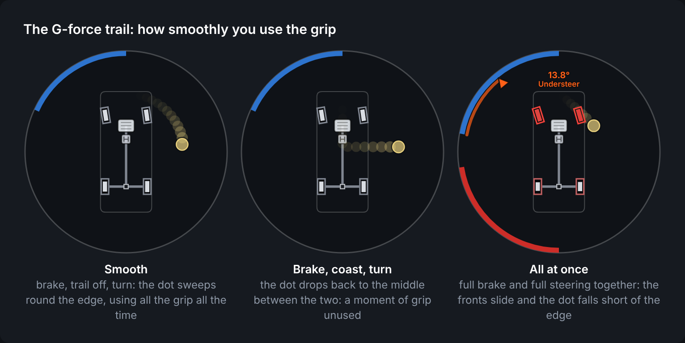

**Reading the G trail:**
- **Smooth:** the trail curves round the edge of the circle. You used all the grip, all the time.
- **Brake, coast, turn:** the trail drops back towards the middle between braking and cornering. For that moment the tyres had grip to spare and you didn't use it.
- **All at once:** full brake and full steering together. The fronts go past their limit (pink or red), the car understeers, and the trail cuts inside the edge: less total force, not more.

**How to practise:**
1. Pick a 90° corner you can take at 60–80 km/h. Brake in a straight line at the threshold.
2. As you start to turn, ease off the brake progressively, about as fast as you add steering. Aim to be off the brake about when you reach the apex.
3. Watch the trail: aim for a smooth curve, close to the edge, with no dip towards the middle.
4. If the fronts go pink as you turn in, you're releasing the brake too slowly or steering too fast; if the trail dips to the middle, you're releasing too early.

**In a rear-drive or mid-engined car**, trail braking also lightens the rear as you turn in, which helps the car rotate. Too much, and the rear gets light enough to slide: *Rear near limit*, then *Oversteer*. That's the same idea as [lift-off oversteer](#lift-off-oversteer), and some drivers use it on purpose.

## Steering with throttle or brake: why the line widens or tightens

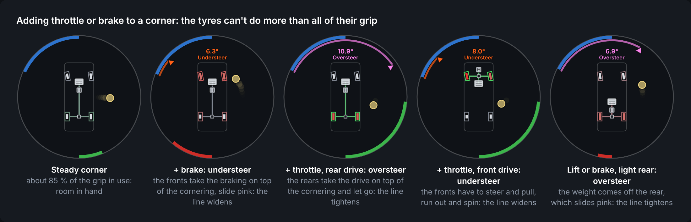

Mid-corner, the tyres are already using most of their grip to turn. Adding brake or throttle asks some of them to do a second job too, and whichever axle runs out first decides what the car does:

- **If the front tyres run out, the car understeers: the line widens.** You run wide however much you steer.
- **If the rear tyres run out, the car oversteers: the line tightens.** The car rotates into the corner, and then may spin.

Which axle runs out depends on the car and on what you add:

| What you add mid-corner | Front drive | Rear drive | All-wheel drive | Mid or rear engine |
|---|---|---|---|---|
| **Throttle, a little** | Load moves back off the front: slight understeer, the line widens a little | Load moves onto the rear, which can help it: usually steadies the car | Usually steadies the car | Load onto an already loaded rear: steadies the car |
| **Throttle, a lot** | The fronts must steer *and* pull: they run out, often the inside one spinning. **Understeer**, the line widens | The rears must corner *and* drive: they let go. **Power oversteer**, the line tightens | Depends on the torque split: rear-biased cars oversteer, front-biased ones understeer, a powerslide in between | Power oversteer, often sudden |
| **Brake** | The fronts take most of the braking on top of the cornering: **understeer**, the line widens | Usually understeer as well. A light rear, or rear-biased brakes, can make it rotate instead | Usually understeer | The rear goes light while still carrying a lot of cornering: **oversteer**, the line tightens |
| **Lift off the throttle** | Load moves forward: the car tucks in, the line tightens slightly (lift-off tuck-in) | The line tightens; with a light rear, it can step out | The line tightens slightly | **Lift-off oversteer**: the line tightens, sometimes sharply |

**What to look for:** watch both axles' bars as you add the pedal, and note which fills first. The marker tells you the result: yellow first (*Front near limit* or *Rear near limit*), then orange-red or pink-magenta. The G-force dot moving forward or back shows the load shifting.

**What to do with it:**
- **Running wide on the power in a front-drive car?** Less throttle until the fronts are white again; the car will turn. Then add throttle as you unwind the steering.
- **Rear stepping out on the power?** Ease the throttle and steer towards the marker (see [Power oversteer](#power-oversteer-catching-a-slide)).
- **Running wide under braking mid-corner?** Less brake, not more steering. The fronts can't do both.
- **Want the car to turn more?** A small lift, or a trail of brake, moves load onto the front and helps it turn, as long as the rear can take it. Watch for *Rear near limit*.
- The general rule: **the more you're steering, the less pedal you can use, and the other way round.** Unwind the steering as you add throttle out of a corner, and finish most of your braking before you add steering going in.

## Finding the limit in a steady corner

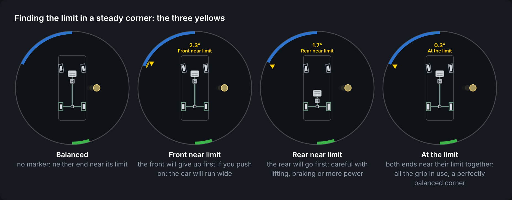

**The skill:** knowing how fast you can take a corner, and which end of the car will give up first.

**What to look for:** drive a steady circle, speeding up a little each lap.
- **No marker:** neither end near its limit.
- **Yellow, *Front near limit*:** the front tyres are near 85–90 % of their grip, and will give up first. Most road cars are set up this way on purpose, because understeer is easier for most drivers to deal with.
- **Yellow, *Rear near limit*:** the rear will go first. Typical of mid- and rear-engined cars, and of rear-drive cars on the power.
- **Yellow, *At the limit*:** both ends near their limit together. That's the fastest a car can corner: all four tyres working fully. Racing setups aim for it.
- **The degrees** at the top say how much more one end is slipping than the other.

**Why it matters:** the yellow is your margin. Once you see it, the car is close; one more step (a bump, more speed, a lift, a stab of throttle) tips it into understeer or oversteer. In practice, the yellow warning is where fast, safe driving lives: on the edge of it, not past it.

**How to practise:** on a steady circle, find the speed where yellow just comes on, and hold it there for a whole lap with small, smooth inputs. Then try the same at the same speed with a little more and a little less throttle, and watch which end the warning moves to.

## Curing understeer

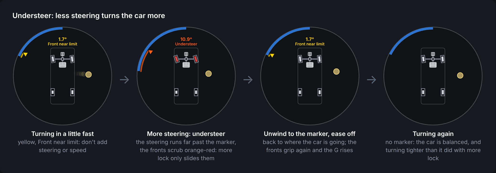

**What it is:** the front tyres past their peak grip, so more steering gives no more turning, only more scrubbing. The car runs wide.

**What to look for:** the steering arc running well past the marker, with an orange-red band between them, *Understeer* at the top, and the front tyres pink or red. The G-force dot doesn't move further out as you add steering; it may even fall back.

**What to do:**
1. **Unwind the steering towards the marker.** This is the counter-intuitive part: the front tyres grip again once their slip comes back down to their peak, and the car turns *more* with less lock. The band shrinks, the fronts go white, and the G-force dot moves out again.
2. **Ease off the throttle** (or the brake), smoothly, so the front tyres have more of their grip for turning. Lifting sharply in a car with a light rear can swap understeer for oversteer.
3. **Next time, brake earlier** or turn in more gently.

**Common mistakes:**
- **Adding more lock.** In the picture above, the steering has more than doubled and the car turns less than before. This is the most common mistake there is, and the one this display shows most clearly.
- **Turning in too fast.** A sudden steering input asks for full grip before the load has moved onto the outside front tyre. Turn in progressively, and *Front near limit* comes on gently instead of jumping to *Understeer*.
- **In a front-drive car, too much throttle mid-corner.** See [above](#steering-with-throttle-or-brake-why-the-line-widens-or-tightens).

## Power oversteer: catching a slide

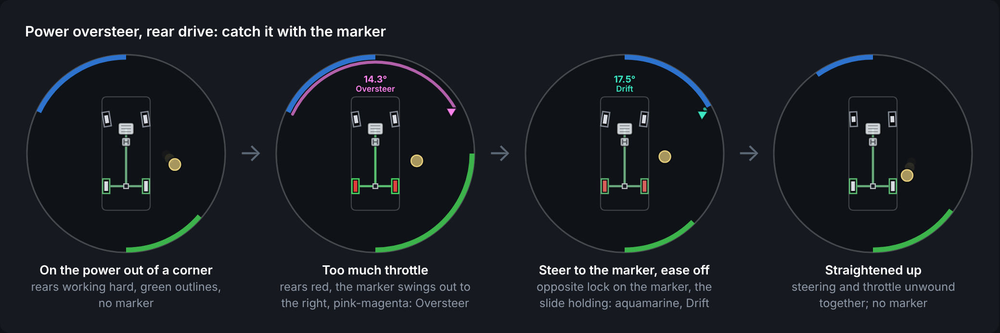

**What it is:** in a rear- or mid-engined, rear-drive car, the rear tyres asked to corner and drive at once, and letting go.

**What to look for:** the rear bars filling (green outlines: they're driving), then pink and red. The marker jumps out to the outside of the turn in pink-magenta, and *Oversteer* shows how many degrees more the rear is slipping than the front. The G-force dot often moves back towards the middle, because a sliding rear gives less force.

**What to do:**
1. **Steer towards the marker.** It sits where the front of the car is travelling: steering at it points the front wheels where they're going, so they grip and pull the nose straight. Follow it as it moves.
2. **Ease the throttle, don't lift.** Lifting sharply moves the load forward off the rear, and can make the slide worse or snap the car back the other way. Bring it down until the rears are pink rather than red.
3. **Once it holds** (aquamarine, *Drift*), unwind the steering and the throttle together as the car straightens.

**What going wrong looks like:**
- **Too slow on the steering:** the marker races off past full lock; the steering arc can't reach it. That's a spin: brake and hold the steering straight (or press the clutch) until it stops.
- **Too much countersteer, held too long:** as the rear grips again, the marker swings back past centre while the steering is still on opposite lock. The car snaps the other way (a "tank-slapper"). Unwind as the marker comes back: always follow it, don't lead it.

## Lift-off oversteer

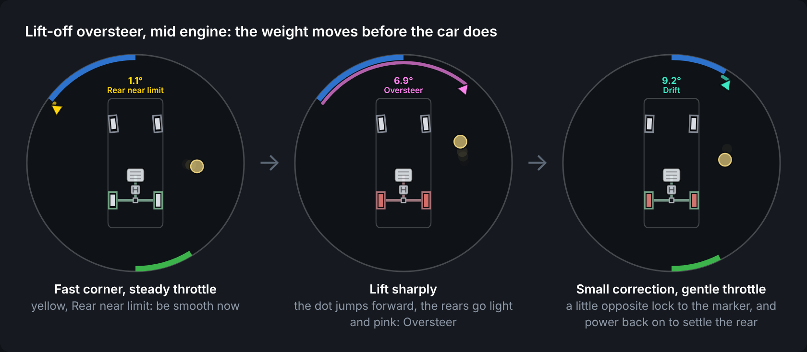

**What it is:** lifting off the throttle (or braking) mid-corner moves load forward. The rear tyres lose load, and so grip, while they're still carrying the corner. In a mid- or rear-engined car, or one already near its rear limit, the rear steps out.

**What to look for:** *Rear near limit* (yellow) beforehand is the warning. Then the G-force dot jumps forward as you lift, the rear outlines turn red (engine braking), the rear bars go pink, and the marker swings out: *Oversteer*.

**What to do:** a small, quick correction towards the marker, and gentle throttle back on to put load back on the rear. Don't lift further or brake.

**How to avoid it:** when you see *Rear near limit*, keep the throttle steady. If you need to slow down, unwind a little steering first, then lift gently.

**Using it on purpose:** a deliberate small lift on turn-in helps a car that understeers to rotate. Done right, the marker goes from *Front near limit* to nothing, or briefly to *Rear near limit*, and the car turns in.

## Drifting

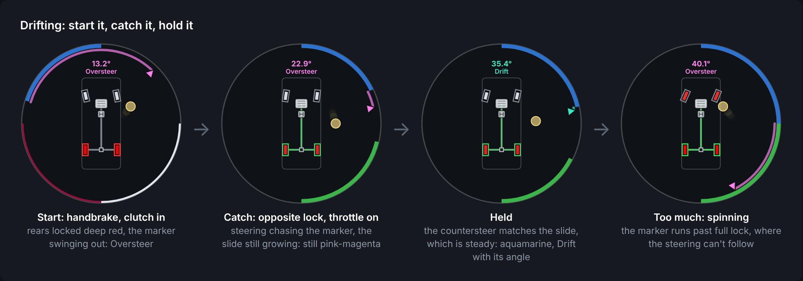

**The skill:** a held slide, the rear sliding at a big angle, the front pointing where the car is going, kept steady with throttle and steering.

**What to look for:**
1. **Starting it** (handbrake, clutch kick, a flick, or a burst of power): the rear goes deep red, the marker swings out in pink-magenta, *Oversteer*.
2. **Catching it:** opposite lock, chasing the marker. It stays pink-magenta while the slide is still growing faster than about 20° a second, or while your steering is well away from the marker.
3. **Holding it:** once your steering sits on the marker and the slide holds steady for 0.2 s, it turns **aquamarine**, and the top shows ***Drift*** with the drift angle: how far the rear is sliding.
4. **Losing it:** if the slide grows past what you can steer (the marker running beyond full lock), it's pink-magenta again: a spin.

**How to hold an angle:** the throttle sets the angle (more throttle, more rear wheelspin, more angle), the steering keeps the front pointing where the car is going (on the marker). To hold 35°, keep the steering on the marker and adjust the throttle until the degrees at the top stay put.

**Practising:** a big circle on a smooth surface. Start the slide, catch it, and try to keep the marker aquamarine for a full lap. Then try to hold a chosen angle, say 30°, within a few degrees. A car with a locked or welded diff is easier: both rears spin together.

## All-wheel-drive powerslides

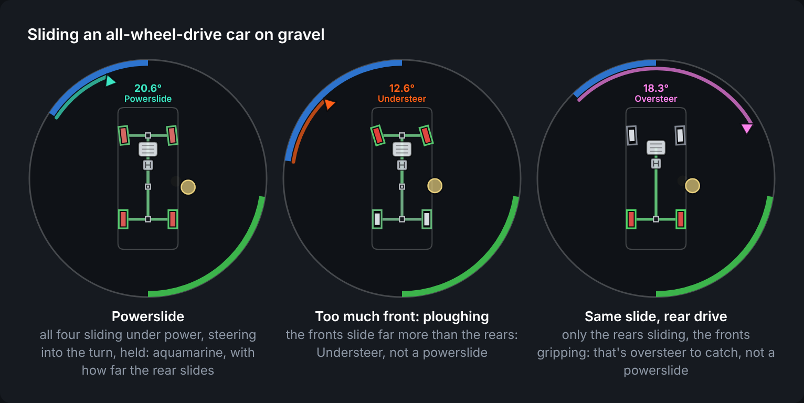

**What it is:** the rally way of sliding an all-wheel-drive car on a loose surface. All four tyres slide under power, the rear more than the front, and you steer *into* the corner: the driven front tyres pull the car round, rather than you catching the rear with opposite lock.

**What to look for:** all four tyres pink, the outlines green, the rear sliding more than the front, the steering into the turn, the throttle on. Once it holds, the marker and the top turn aquamarine: ***Powerslide***, with how far the rear is sliding.

**What going wrong looks like:**
- **Ploughing:** the fronts sliding far more than the rears, the car running wide. That's *Understeer*, not a powerslide. Less steering, and a lift to move load forward, or a dab of brake (left-foot braking) to rotate it.
- **Rear getting away:** the slide growing into a spin turns it pink-magenta (*Oversteer*). Catch it with the steering like a rear-drive car.
- **The same slide in a rear-drive car** is oversteer to catch, not a powerslide: the fronts can't pull it round.

## Launches and traction

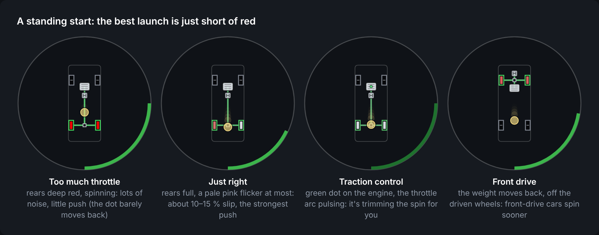

**The skill:** the quickest getaway: the drive wheels at their peak, about 10–15 % slip.

**What to look for:**
- **Too much throttle:** the drive wheels deep red. They're spinning far past their peak, so they push less. The G-force dot hardly moves back.
- **Just right:** the drive wheels' bars full, at most a pale pink flicker. The G-force dot as far back as it goes.
- **Traction control:** a green dot (on the engine for classic traction control, by the wheels for newer cars) and a pulsing throttle arc. It's cutting power or braking the spinning wheel for you. If you see it all through a launch, you're asking for more than the tyres can take; less throttle may be just as quick and smoother.
- **Front drive:** accelerating moves load back, off the driven front tyres. Front-drive cars spin their wheels sooner, and the pink comes earlier.

**How to practise:** launch with full throttle and note the colour, then try again with less, until the bars are full and the colour no more than pale pink. Watch the G-force dot: the launch that pushes it furthest back is the quickest. In a manual car, the clutch arc shows how fast you're letting it out.

**Out of a slow corner** it's the same, plus steering: the inside drive wheel carries the least load and spins first (see [Differentials](#differentials)).

## Load transfer and rollover

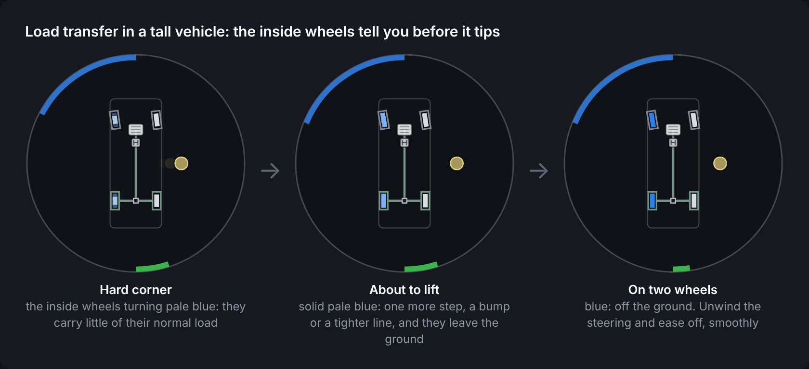

**What it is:** in a corner the load moves onto the outside wheels; under braking onto the front, under power onto the rear. In a tall vehicle (a pickup, a van, a bus, a truck) the inside wheels can lose so much load that they leave the ground, and then it may roll.

**What to look for:**
- **Pale blue** creeping into the inside wheels: they're down to less than a quarter of their normal load. The deeper the pale blue, the less is left.
- **Solid pale blue:** about to lift.
- **Blue:** off the ground. With two wheels up, the vehicle is balancing on the other two.

**What to do:** unwind the steering smoothly and ease off. A sudden steering correction, or braking hard while on two wheels, can tip it further. A wheel showing pale blue also has very little grip: in a corner, the outside tyres are doing nearly all the work.

Some compact front-drive cars do this on purpose: stiff at the rear, they lift the inside rear wheel in a hard corner and run on three wheels ("tripod mode"). The inside rear goes pale blue, then blue, while the car carries on round the corner; with the load on the outside wheels and the fronts doing the driving, that's normal for those cars. The tour at the top shows one.

The same pale blue shows other load changes: the rear wheels of a car braking hard, the front of a powerful car launching, a wheel at full suspension droop on rough ground, or diagonally opposite wheels on an off-road vehicle crossing a ditch.

## Kerbs, crests and jumps

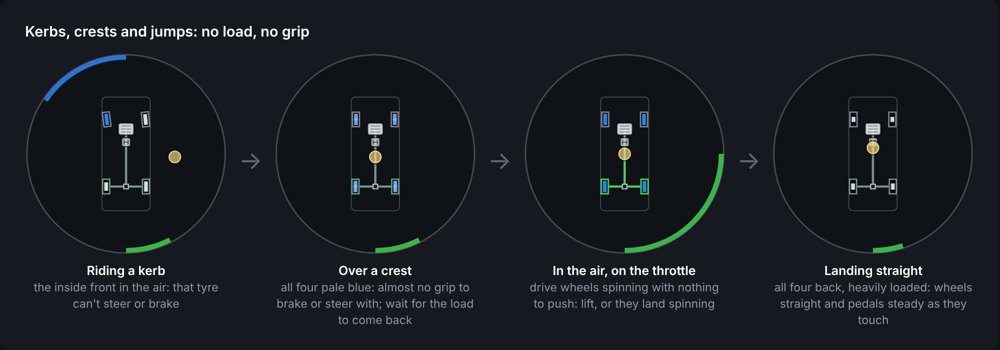

**The point:** a tyre with no load has no grip. It can't steer, brake or drive.

**What to look for:**
- **A kerb** lifts a wheel: blue. That corner of the car isn't doing anything, so the others carry the whole corner.
- **A crest** lightens all four: pale blue. Steering or braking over a crest asks for grip that isn't there: a lift-off slide or a lock-up waiting to happen.
- **In the air**, all four are blue. A drive wheel still under power spins up (green outline); when it lands spinning it kicks the car sideways.
- **Landing** loads every tyre heavily for a moment.

**What to do:** brake before a crest, not on it. Over a jump, land with the wheels straight and the throttle steady or lifted, so the drive wheels aren't spinning when they touch. Don't use the inside kerb if the inside wheels are already pale blue.

## Surfaces

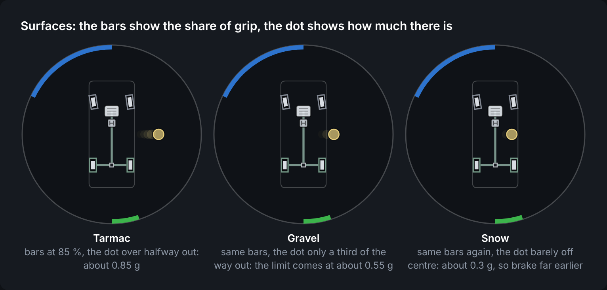

**The point:** the grip bars show the *share* of grip in use; the G-force dot shows how *much* grip there is. On every surface a full bar means "at the limit", but the limit comes at very different forces.

**What to look for:** on tarmac a road car reaches the limit with the dot about two-thirds of the way out (1 g); on gravel perhaps a third of the way out; on snow or ice, barely off the middle. The display learns each axle's grip as you drive near its limit, so after a change of surface the bars may read low (or high) until the car has been near its limit there (see [Known limits](#known-limits)).

**How to use it:** on a new surface, find the limit gently, braking in a straight line until the fronts fill, and note how far out the G-force dot gets. That's how hard you can brake or corner there: everything happens at that fraction of the force. A surface change mid-corner (a patch of ice, wet paint, gravel on the apex) shows as tyres going pink with the G-force dot suddenly smaller.

## Differentials

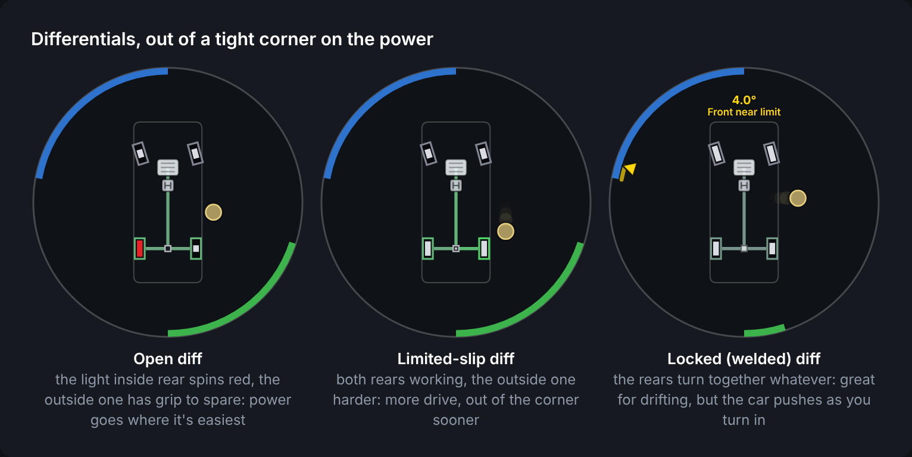

The differential decides how the drive is shared between the left and right wheels. The display draws its type (hollow: open; centre block: limited-slip; solid: locked) and shows each wheel's grip, so you can see what it does.

- **Open diff:** both wheels get the same torque, and that's limited by the wheel with less grip. Out of a tight corner, the light inside wheel spins red while the outside one has grip to spare. Ease the throttle until the inside one is white again. Traction control often brakes that wheel for you (a green dot).
- **Limited-slip diff:** it sends more torque to the wheel with more grip. Both bars work, the outside one harder, and you get more drive out of the corner. Too much power still overwhelms both, and on a rear-drive car, both rears letting go together is a quicker slide.
- **Locked or welded diff:** both wheels turn at the same speed whatever. Excellent traction and easy drifting, but in a corner the inside wheel is dragged round faster than it wants to go, which pushes the car straight on. Watch for *Front near limit* or *Understeer* on turn-in, and a sudden step out when both rears let go together.
- **Selectable lockers and active diffs:** a locker you engage turns solid, and an active diff shows how hard it's clamped right now.
- **All-wheel drive:** watch the centre diff and the shafts. An on-demand system's rear shaft only turns green when it starts sending drive back; a locked centre makes both axles turn together, which helps traction off road and makes tight turns on tarmac scrub.

## Learning from the assists

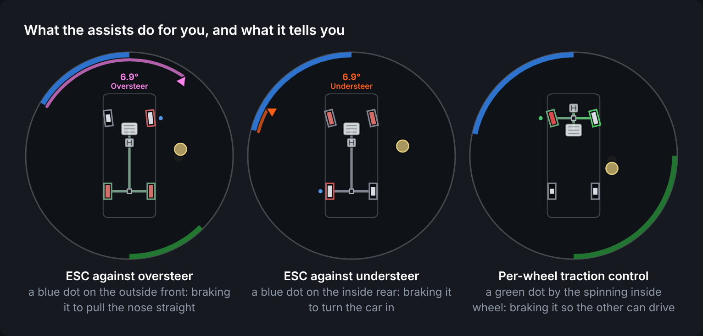

The assists react to the same things you're learning to see, so their dots tell you what you just asked the car to do:

| You see | The assist is | It means you |
|---|---|---|
| Red dots, brake arc pulsing | ABS, releasing wheels about to lock | Braked harder than the tyres can take. Fine in an emergency; for practice, find the threshold just below it |
| Blue dot on the **outside front** | ESC braking it to pull the nose straight | Got the rear sliding: oversteer |
| Blue dot on the **inside rear** | ESC braking it to turn the car in | Asked for more turning than the fronts can give: understeer |
| Green dot on the engine, throttle arc pulsing darker | Classic traction control cutting power or braking a spinning wheel | Asked for more drive than the tyres can take |
| Green dot by one wheel | Per-wheel traction control braking that wheel | That wheel was spinning, usually the light inside one out of a corner |
| Throttle arc pulsing darker, no green dot | ESC cutting engine power | Were sliding on the power, and ESC is reining it in |

A good exercise: drive a lap with the assists on and count the dots. Then try to drive the same lap with none showing at all, and you've learnt to stay just inside the limit.

## Setting up a car with it

The display shows what a setup change actually does to the tyres. Drive the same corner the same way before and after a change, and compare.

**First, find where the problem is.** Most handling complaints happen in one phase of a corner, and the display tells you which:

| Phase | What to watch |
|---|---|
| **Braking in a straight line** | Which axle's tyres go pink first. Rears first: brake bias too far back |
| **Turn-in, on the brakes** | *Front near limit* or *Understeer* (entry understeer), or *Rear near limit* or *Oversteer* (entry oversteer) |
| **Mid-corner, steady** | Which yellow comes first on a steady circle. *At the limit* is ideal |
| **Exit, on the power** | Front-drive: the inside front spinning, *Understeer*. Rear-drive: the inside rear spinning (open diff), or both rears going, *Oversteer* |
| **Lifting mid-corner** | *Oversteer* right after the dot jumps forward |

**Then the usual first things to try** (general setup principles: every car differs, so change one thing at a time and check the result on the display):

| Symptom | Usual first changes |
|---|---|
| Understeer mid-corner | Softer front anti-roll bar, or stiffer rear; more negative front camber; more front downforce or less rear |
| Oversteer mid-corner | The reverse: stiffer front anti-roll bar, or softer rear; more rear downforce |
| Understeer on entry, braking | Brake bias a little rearwards; softer front |
| Oversteer on entry, braking | Brake bias forwards; less diff coast lock (rear drive) |
| Power oversteer on exit | Softer rear anti-roll bar or springs; less diff power lock; smoother throttle |
| Inside wheel spinning on exit | More diff lock (a limited-slip diff instead of an open one, or a higher power lock) |
| Power understeer on exit (front drive) | Less front diff lock, or a softer front; or less throttle until the wheel is straighter |
| Lift-off oversteer | More diff coast lock; softer rear; a gentler lift |
| Rolling onto two wheels | Lower ride height, stiffer anti-roll bars, wider track, less speed |

Things to check while you do it:

- **Is the diff locked?** It's solid on the diagram when it is.
- **Is 4WD engaged, and is the front axle driving?** The shafts are green to every driven wheel, and a disconnected shaft has a hollow diamond and grey dashes beyond it.
- **Is the on-demand AWD doing anything?** Its rear shaft turns green only when it's sending drive.
- **Is the brake bias right?** Brake hard in a straight line: the fronts should reach full a little before the rears.

## More things it's good for

- **Learning a new car.** A few laps on a steady circle tell you which end goes first, how much warning you get between yellow and orange-red or pink-magenta, and how far the G-force dot gets at the limit.
- **Comparing cars, tyres and setups.** How far out the G-force dot gets at the limit, and which yellow shows first, is a quick, repeatable comparison.
- **Off road.** Which wheels are driving, which are in the air or nearly (pale blue on articulation), whether the lockers are in and the hubs locked, and which wheel is spinning.
- **Towing.** The trailer's wheels show their own load, grip and lock-ups, and the trailer's inside wheels going pale blue warn of a trailer about to tip.
- **Trucks and buses.** Duals and tandems, which axle drives, and a tall body's inside wheels going light.
- **Checking a mod.** Does the drivetrain go where the author says? Are the diffs the right type? Does the traction control do anything? Does ABS act on every wheel?
- **Streaming and coaching.** Viewers, or a student, can see exactly what the tyres were doing and why the car did what it did.
- **Working out what went wrong.** Pause the moment a car gets away from you: the display still shows which tyre went first, whether a wheel was locked, and whether the inside wheels were already light.

## Common mistakes, and how they look

| You see | What happened | What to do instead |
|---|---|---|
| Fronts deep red under braking, the G-force dot moving back | A lock-up | Ease the brake until they're white or pale pink |
| Steering arc far past an orange-red marker | Understeer: you added lock the fronts can't use | Unwind to the marker, ease off the pedal |
| G-force trail drops to the middle between braking and turning | A gap: grip unused | Release the brake as you add steering (trail braking) |
| Fronts pink and *Understeer* as you turn in on the brakes | Too much brake still on for the steering | Release the brake sooner, or turn in more gently |
| Inside drive wheel red out of a slow corner | Wheelspin: open diff, too much throttle | Less throttle until it's white, more as you unwind the steering |
| Rears red, marker swinging out, out of a corner | Power oversteer | Ease the throttle, steer to the marker |
| *Rear near limit*, then *Oversteer* the moment you lift | Lift-off oversteer | Keep the throttle steady when the rear is near its limit |
| Marker swinging back past centre while you're on opposite lock | The rear has gripped again | Unwind as it comes back; follow it, don't lead |
| Drive wheels deep red at a standstill | Too much launch throttle | Less, until they're full and pale pink at most |
| Inside wheels pale blue in a tall vehicle | Close to lifting | Less steering, less speed, smoothly |
| A wheel turning blue, then red as it lands | Braking or driving through a jump or a crest | Wheels straight and pedals steady over the top |
| ABS or traction control dots all the time | Driving on the assists | Find the limit just below them |

---

# How it measures

This part is for the curious, and for anyone tuning the settings. Nothing here is needed to use the display.

## The parts of the mod

| File | Runs in | What it does |
|---|---|---|
| `lua/vehicle/extensions/vgsTelemetry.lua` | Each displayed vehicle | Measures the wheel layout, body outline, mass and centre of gravity once, and maps the drivetrain. Then, every graphics frame, it works out each wheel's grip, slide, torque, steering and assists, the inputs, the G-force, the direction of travel and the balance. Whenever the UI is ready for a frame, it sends them straight to the app as the `VGSData` UI hook. |
| `lua/ge/extensions/vgsHub.lua` | The game engine | Finds the vehicle you're driving and everything coupled to it, and keeps the telemetry running on exactly those. Four times a second it tells the app which vehicles make up the player's chain (`VGSChain`), which also tells it the game is still there while paused. It passes the app's requests to the vehicles (the balance's values on or off, resend the layout) and has the [console commands](#console-commands). |
| `ui/modules/apps/VGSDisplay/app.js` | The UI | Keeps each vehicle's layout and latest data, puts the chain in order front to back, lays everything out and draws it on a canvas once per screen refresh. The renderer has no BeamNG dependencies, so the same file also runs in a plain browser (that's how the images in this README are made). |
| `ui/modules/apps/VGSDisplay/app.json`, `app.png` | The UI | The app's name, category, default size and icon. |

When you open the app, it loads and enables the hub; when you close the last copy, it disables the hub, which stops the telemetry on every vehicle. The wheel layout is measured once per spawn or reset, preferably while the steering is centred (it waits up to 1.5 s for that), and the drivetrain is mapped at the same time. A reset (R) gives the layout a new version number, so the app picks up the new one.

Everything the vehicle script does runs protected: a problem in the display is logged (at most every 10 s) and the display restarts itself. It can never stop the vehicle.

## The grip bar

BeamNG doesn't report a "friction used" figure per tyre, so the bar is an estimate: the force the tyre is making against the force it can grip with.

- **Sideways:** the tyre's share of its axle's cornering force. The axle's force comes from the grip model (see [How near each end is to its limit](#how-near-each-end-is-to-its-limit)): the car's mass and centre of gravity, its sideways acceleration and how fast its rotation is changing, with the drive and brake forces allowed for. It's shared between the axle's tyres by their load: a more heavily loaded tyre is stiffer and takes more of it, a little less than in proportion (`GRIP_LOAD_EXP`).
- **Forwards:** the drive and brake torques on the wheel, divided by its radius.
- **What it can grip with:** its load, BeamNG's own figure for that wheel, times its axle's grip (friction coefficient). The grip starts at a road tyre's on tarmac (`MU_NOMINAL`, 1.0) and is learnt as you drive. It's raised whenever the axle uses more than that, and right at the axle's peak, where the force *is* the grip, it's measured (`MU_TAU`). So race slicks, all-terrain tyres and loose surfaces read right once the car has been near its limit.
- **At or past the limit:** an axle past its peak shows its tyres full, and the tyre's own slip counts too: its contact-patch slip speed divided by `SLIP_PEAK` (1.5 m/s), so a sliding or spinning tyre always shows.

Before 1.0 every tyre took the same share of the car's sideways acceleration, against a fixed grip of 1.0, so a front tyre at its limit in understeer could read 70 % and a race tyre read high all the time. In the simulation (see [How it was tested](#how-it-was-tested)) the bar's average error fell by about a quarter across the test fleet, from 7.7 % to 5.9 % of the tyre's grip. Tyres far from a road tyre's grip (slicks, gravel) still read off until the car has been near its limit and the grip has been learnt.

Since 1.20 the bar uses quicker inputs than the limit test does: the sideways acceleration as the G-force dot has it (the turn at once), the change of rotation and the wheel loads smoothed only lightly (`GRIP_BAR_HZ`), and less smoothing at the end (`GRIP_SMOOTHING`). In the simulation it trails the tyre's true grip use by under 10 ms, against about 100 ms in 1.10. The limit test keeps its own slower, matched inputs, so the warnings are unchanged. A held brake at a standstill doesn't count as tyre force. A wheel shown off the ground reads empty at once.

## Sliding and slip ratio

A tyre counts as sliding when its contact-patch slip goes above `SLIP_LIMIT` (2 m/s by default). It stops counting once the slip drops below 80 % of that (`SLIP_RELEASE`), so it doesn't flicker on and off right at the line. While it's sliding, the bar fills the whole tyre, and its colour shows how far past the limit it is, from its slip ratio: pink up to `SLIP_RATIO_PINK` (30 %), deepening to full red at `SLIP_RATIO_FULL` (100 %). `PINK_SEVERITY` sets how far towards red the colour has moved by the end of the pink band.

Below 18 km/h (5 m/s, `RATIO_MIN_SPEED`) the ratio is worked out against 18 km/h instead of the real speed, so it doesn't jump around at a crawl or divide by zero when stopped.

> **Note:** whether a tyre counts as sliding at all is still decided by slip speed (`SLIP_LIMIT`), not slip ratio. At 90 km/h, 2 m/s is about 8 % slip, a little before a real tyre's peak. The pink band covers the gap.

Some background from BeamNG's own code: its tyres use a Stribeck friction model, where grip depends on how fast the contact patch is sliding (its slip speed), not on the slip angle as such. The default surface has a static friction of 1.0, a sliding friction of 0.7, and a Stribeck speed of 6 m/s (each tyre can scale that with `stribeckVelMult`), so grip falls away gradually over several m/s of slip. That's why the limit is set by slip speed. BeamNG's ABS aims for about 18 % slip ratio (`slipRatioTarget`), a useful check that the pink band ends in the right place.

## The G-force measurement

BeamNG's physics is very fast and precise, so the body's vibration and every bump in the road show up in the raw acceleration as jitter. So the dot is measured in a way that keeps it steady without trailing behind:

1. **Sideways, most of it is the turn itself:** forward speed × yaw rate. The physics gives the yaw rate at once and smoothly (it's the value BeamNG's own stability control uses), so that part comes with no delay.
2. **The rest** (a slide's sideways speed changing, and all of the forward and backward force) comes from the least-squares slope of the velocity over the last 0.1 s (`GF_WINDOW`), which averages out vibration much better than the difference between two samples. Sideways, it's compared with the turn as it was in the middle of that window, so the slope's half-window delay doesn't come along, and only what's left goes through a slow filter (`GF_TURN_HZ`).
3. **Two smoothing stages** follow, at a cutoff that's low while the force holds steady (`GF_MIN_CUTOFF`), so the dot sits still, and opens up for changes faster than a rough road shakes it (`GF_D_FLOOR`, `GF_BETA`): a turn-in, a stab of the brakes.

In a simulated test, with body vibration, a rough road and noise on the yaw rate, it follows a turn-in about 35 ms behind the true force and a straightening-up about 15 ms behind. Before 1.20 that was 85 ms and 170 ms. It wobbles about 1–2 mg per frame, as before. Because it's measured from the change in velocity, it reads zero when parked on a hill.

## Direction of travel

- **Direction:** each axle's direction of travel is measured straight from its hub nodes (the frontmost axle, and the middle of the rear wheels, so the middle of a tandem on a truck): how far they've actually moved over the last 0.06 s (`TRAVEL_WINDOW`), against the way the car pointed over the same time. Measuring over a short stretch rather than frame to frame averages out the hubs' vibration. If the hub nodes can't be read, it falls back to the vehicle's velocity plus how fast it's rotating (its yaw rate, the physics value BeamNG's own stability control uses) times the distance to the axle.
- **While the rear grips, from the yaw rate:** how much the car is turning, as a steering angle, is the front axle's direction against the rear axle's path. For a rigid car that's exactly the wheelbase times the yaw rate over the forward speed, so that's what's used: the physics yaw rate and the forward speed, with no differentiated node positions in it, so it's free of the hubs' vibration. A running least-squares fit keeps it calibrated against the hub measurement (`TURN_CAL_TAU`), so it's right on average without carrying the hubs' noise. Once the rear slides, the hub measurement takes over, where the angles are large.
- **Lined up with the steering arc:** the arc shows your steering input, so the marker is converted into the same units with the ratio the front wheels actually show right now: a running least-squares slope of front-wheel angle against steering input over the last second (`RATIO_TAU`). At speed the wheels usually turn less per unit of input than near full lock (the steering gives under cornering load, and its geometry isn't linear), and with the full-lock ratio the marker sat well short of the arc even with the tyres balanced. Each update counts in proportion to how far you're steering, so the wheel-angle measurement's noise averages out, and updates on a straight (input near zero) carry almost no weight: nothing is divided by a near-zero angle, which is what made an earlier version jitter on straights. Now the marker meets the arc whenever the front and rear tyres slip equally, so any gap is the tyres. In normal fast driving that gap is the car's ordinary handling: in the simulation, at 90 to 126 km/h, the marker sat 5 to 8° of rim behind the steering with the balance neutral (whatever the steering's give), and 20° or more behind with worn front tyres, with the understeer warning on.
- **Straight ahead stays straight ahead:** each wheel's straight-ahead angle is captured with the layout while the steering input is centred (under 0.4 % input, about 0.1° of road wheel, `CENTRE_INPUT`). If the steering wasn't centred within 1.5 s, it's taken the first time it is. After that it's kept true whenever you're really driving straight: no steering input, the car not rotating, moving (`CENTRE_TAU`). An off-centre capture, or a knock to the alignment, would otherwise leave a constant offset, which at highway steering angles is as big as the steering itself.
- **Why the rear axle:** the front axle's direction measured against the body isn't what the car is doing in a corner at speed. The rear tyres need a few degrees of slip to corner, so the whole car crabs slightly nose-in, and against the body the front axle's direction sits near the middle, or even on the outside of the turn, while the car is clearly turning. Measured against the rear axle's path instead, it's exactly the steering angle that matches the car's turn. That's what the marker shows while the rear slip angle is under about 8° (`REAR_GRIP_SLIP`). Between 8° and 20° (`REAR_SLIDE_SLIP`) it eases over to the front axle's direction against the body, which is what you steer to once the rear is really sliding.
- **Scale:** the full-lock angle of the front wheels is learned while you drive, from how far they actually turn for a given steering input. Until you've steered a little, it assumes about 34° (`LOCK_DEFAULT`). The marker can go round a full circle, four times that angle (`TRAVEL_MAX`).
- **Spins and donuts:** an axle sliding backwards counts as rolling backwards, not as sliding the other way, so a spin stays pink-magenta instead of flipping to understeer. The direction of rotation comes from the yaw rate, which keeps its sign through a drift or a spin. The marker is also kept continuous past 180°: in a spin it stays on the side it started, and only comes round to the other side once the car has really rotated about three-quarters of a turn.
- **Low speed:** measured from the hubs, it wobbles by well under a degree down to about 0.5 m/s, even with the hubs shaking by a few millimetres; below that it grows quickly, and a car settling or rocking at a stop would swing it about. So it fades in between 0.5 and 1.5 m/s.

## How near each end is to its limit

The marker's colour, and the words at the top, come from how near each end of the car is to its limit. This uses what BeamNG's own stability control knows about the car.

- **BeamNG's calibration.** For its stability control, BeamNG calibrates each car's tyres: the *cornering stiffness* of the front and rear axle, how much sideways force they make per degree of slip while well within their grip. Cars with the driving-dynamics system carry it in a calibration file per configuration (`vehicles/<car>/drivingDynamics/<config>.stat.json`, 174 of them in 0.40: the Bastion, ETK 800 and K series, SBR, Scintilla and Vivace families); cars with the classic ESC carry it in their ESC settings. BeamNG's ESC uses these values to predict the yaw rate the car should have for your steering and speed (its "characteristic speed"), and treats more rotation than that as oversteer and less as understeer.
- **Learnt when there's no calibration.** Other vehicles learn it while you drive: about 2.5 s of gentle cornering (up to about a third of the grip, `CAL_AY_HI`) is enough, and it keeps refining from then on (`CAL_TAU`). The fit follows the tyre's early bend (`CAL_BEND_PRIOR`, `CAL_BEND_SHARE`), so it finds the tyre's true starting stiffness. A straight line through the same data comes out 10–25 % low for a BeamNG-like tyre, whose tread starts to slide node by node from the first degree, and that read as being nearer the limit than it was. Straight running counts too: it pins down any small constant error in the measured slip, which matters most for stiff tyres. A calibrated car refines BeamNG's values the same way, slowly. After a dozen seconds of gentle weaving, the learnt stiffness of every vehicle in the test fleet was within 10 % of the true value, and half of them within 5 %.
- **How near the limit.** Each axle's sideways force is worked out from the car's mass, where its centre of gravity sits between the axles, its sideways acceleration and how fast its rotation is changing. Three things that turn the car besides the tyres' cornering force are allowed for:
  - the tyres' forward forces, from the drive and brake torques on each wheel. A limited-slip or locked diff pushing the inside wheel harder, a brake on one wheel (ESC), or torque vectoring turns the car, and before 1.0 that was put down to the axles' cornering forces. On a rear-drive car with a limited-slip diff this made the rear look 10 % nearer its limit than it was, and the learnt stiffness 30 % off at the front;
  - the steered wheels' forward force, part of which pushes sideways;
  - a tandem's axles, which roll along different paths and so push against each other in a turn, resisting it more the stiffer and further apart they are.

  That force is set against the force its tyres would make at their current slip angle if they were still in their linear range (stiffness × slip). The stiffness follows the load the axle's tyres carry right now, from BeamNG's per-wheel load: a tyre gets stiffer with load, a little less than in proportion (`GRIP_LOAD_EXP`), so braking (more load on the front) or load transfer in a corner isn't mistaken for the limit coming or going. The ratio is 1 well within the grip and falls as the tyres near their peak, to about the same value at the peak whatever the tyre, a stiff race tyre or a soft off-road one (`GRIP_RATIO_PEAK`). So the limit is found for each car, with no fixed angles. The signals behind force and slip are timed to line up, so a quick turn-in or a slalom isn't mistaken for running out of grip, and the slip is compared with where the wheels pointed at the same moment, so turning the steering isn't mistaken for slip.
- **The states.** An axle counts as near its limit from about 85–90 % of its grip (`NEAR_ON`; it has to stay there 0.12 s, `WARN_HOLD`). Whichever end is clearly nearer gets the warning; when they're within `LEAD` of each other it's *at the limit*. *Understeer* is the front at its peak, where more steering gives no more force (`PAST_ON`), and further gone than the rear. Before 1.0 it came on as soon as the warning was at full strength, at about 75 % of the way to the peak, so a car near but not past the limit read as understeer. *Oversteer* is the rear slipping more than the front, beyond what linear tyres would need for the forces, with the rear near or past its limit. That takes the car's own designed balance out of the oversteer test, as BeamNG's ESC does with its expected yaw rate. A car that's naturally a little tail-happy reads as oversteer only when it really is, and a nose-heavy one doesn't hide a sliding rear. While the rear is sliding, the warnings stand down: that's oversteer or nothing.
- **Until the stiffness is known**, a fresh car without BeamNG's calibration uses fixed slip angles instead: the warning on the front slip angle on its way to a road tyre's peak, from about 2.5° (`US_SLIP_START`) to 7° (`US_SLIP_FULL`) with the front slipping 0.3° (`US_LEAD_START`) to 2° more (`US_LEAD_FULL`) than the rear; understeer from 7° (`US_PAST_START`) to 10° (`US_PAST_FULL`) of front slip with the front 2° (`US_PAST_LEAD`) to 4° (`US_PAST_LEAD_FULL`) more than the rear. Fine for a road tyre, but it warns early on soft tyres and late on stiff ones. Below walking pace (4–7 m/s, `GRIP_MIN_SPEED`) the slip angles are too small to judge, so it also uses these there.
- **Oversteer (pink-magenta)** shows once the rear is clearly sliding more than the front: the difference has to pass about 3° (`BAL_DEADBAND`), reaching the full strength at about 12° (`BAL_FULL`), and the rear has to be working hard: near its limit, or past about 4.5° of slip (`BAL_SLIP_START`), with full strength from about 8° (`BAL_SLIP_FULL`). The rear sliding past any tyre's peak, from about 12° to 20° (`OS_SLIDE_START`, `OS_SLIDE_FULL`), is oversteer whatever the front is doing. In a spin the front slides too, so the difference between them says nothing, and before 1.0 a full spin showed no marker at all.
- **Quiet when straight and slow.** Both go back to neutral (no marker) when the car is barely rotating (below 0.1 rad/s for understeer, `US_MIN_YAW`, and 0.15 rad/s for oversteer, `BAL_MIN_YAW`), so straight-line driving stays clear. At a crawl (both axles under about 1.5–3 m/s) the directions of travel mean nothing, so a car stopping or pulling away shows nothing either, but a donut, where the rear is moving fast though the middle of the car hardly moves, still counts. The balance also clears when you select reverse.
- **Tested in the simulation** against the true grip of each axle: see [How it was tested](#how-it-was-tested) for the fleet, the manoeuvres and the results.

## Drift and powerslide detection

**A controlled drift (aquamarine instead of pink-magenta)** needs two things. Aquamarine because a controlled drift isn't a warning: it's a "good, in control" green, shifted towards cyan so it doesn't clash with the throttle arc or the drive outlines. In a colour-blindness simulation it stays distinct from the pink-magenta, the yellow and the orange-red.

- **The countersteer matches the slide:** the front tyres slip only a few degrees, meaning the steering points about where the front is going. It's fully controlled up to 5° of front slip (`DRIFT_STEER_OK`) and not controlled from 15° (`DRIFT_STEER_OFF`).
- **The slide isn't growing fast:** growing by up to 20° a second still counts (`DRIFT_GROW_OK`); from 57° a second it's spinning away (`DRIFT_GROW_OFF`). A slide that's shrinking, because you're recovering, counts as controlled.

Past 90° of slide it's a spin, whatever the steering (`DRIFT_MAX_ANGLE`). The vehicle's drift-control value moves smoothly; the marker turns aquamarine once it's past 0.6 for 0.2 s, and back to pink-magenta as soon as it drops below 0.45. It's usually aquamarine within about half a second of the slide holding.

In the simulation, held drifts at 30° and 40° with matching countersteer came out aquamarine. A drift with the steering 20° off, a slide growing into a spin, and lift-off and power oversteer spins all stayed pink-magenta.

**A powerslide (aquamarine)** is the all-wheel-drive way of sliding: all four tyres sliding under power, you steering into the corner and the driven front tyres pulling the car round, rather than catching the rear with opposite lock. The front slides nearly as much as the rear, so the oversteer test doesn't see it and the drift test (the front nearly gripping) rejects it; before 2.5 it showed as oversteer, or as nothing at all when the front slid as much as the rear. It needs:

- both axles driven right now (so it follows a 4WD switch or transfer case);
- the rear sliding out, from about 6° to 10° (`PS_REAR_START`, `PS_REAR_FULL`);
- the front sliding into the turn too, from about 2° to 4° (`PS_FRONT_START`, `PS_FRONT_FULL`), but not far more than the rear: 5° to 10° more is ploughing (`PS_PLOUGH_START`, `PS_PLOUGH_FULL`), which is understeer;
- the throttle on, from 20 % (`PS_THROTTLE`), above walking pace.

It's controlled when the slide holds, as for a drift (not growing faster than about 20°/s, never past 90°). It turns aquamarine once it has held for 0.2 s, and pink-magenta (oversteer) the moment it gets away. The degrees at the top of the circle are how far the rear is sliding. In the simulation, three all-wheel-drive powerslides (20° to 35°, the front sliding 10° to 18°) all read *Powerslide*. The same slide with rear-wheel drive, a lift-off slide, a slide growing into a spin, a plough, a classic opposite-lock drift and ordinary cornering read as before.

## The marker's smoothing

At highway speed the stretched scale magnifies the smallest movement, so the marker's smoothing is designed to be steady without trailing. There's one adaptive ("One Euro") filter, applied in the vehicle at full game rate to where the marker is drawn (degrees round the rim, after the scale's magnification, so noise is judged as you'd see it).

- **Holding still:** it smooths strongly (`MARK_MIN_CUTOFF`).
- **When the marker moves:** it opens up as the marker itself moves (`MARK_BETA`), and a little as you turn the steering (`MARK_STEER_GAIN`), which is a clean, delay-free signal. Only a little, because the car hardly responds to small quick corrections.
- **Big, fast swings:** movement faster than noise can produce (`MARK_FAST_FROM`) opens it almost at once (`MARK_BETA2`).
- **Once the rear slides:** the smoothing fades out, because the marker then comes from the hubs' measurement, which is already smoothed and moving a long way.
- **What feeds it:** the yaw rate straight from the physics, unfiltered since 1.20 (`MARK_YAW_HZ` 0). The marker's own filter is enough, and it opens up twice as readily as before when the marker or the steering moves (`MARK_BETA`, `MARK_STEER_GAIN`). In the simulation the marker now trails the car's turn by about 10 ms, against about 30 ms before; the extra movement while it holds still is a few hundredths of a degree of rim.

In the simulation, with yaw-rate noise and hub vibration, against the earlier fixed smoothing (before 2.1):

| | Fixed smoothing | Adaptive filter |
|---|---|---|
| Frame-to-frame wobble on a straight at 108 km/h | 0.63° of rim | 0.15° |
| Wobble in a highway curve | 0.30° | 0.05° |
| Delay behind the car's actual turn (lane change, step steer, slalom, town corners) | 60–84 ms | 20–30 ms (about 10 ms since 1.20) |
| Delay in a slide | none | none |

Steady corners sit exactly where they did.

## How the assists are read

Two kinds of assist system are covered:

- **The classic ESC script** that most vehicles use, with ABS in BeamNG's wheel code. They report what they're doing through the electrics flags `absActive`, `tcsActive` and `escActive`. (The similar-looking `abs`, `tcs` and `esc` values are the dashboard lights, which blink on a timer, so they aren't used.)
- **BeamNG's newer driving-dynamics electronics** (the Vivace, for one). Traction control and ESC are separate supervisors (`tractionControl`, `yawControl`) that say when they're acting. The parts that carry their decisions out say what they're doing too: `motorTorqueControl` cuts engine power, and `brakeControl` brakes wheels. Each reports whether it's acting for traction control, ESC or ABS. On these cars ESC often works by cutting power. Holding the car on full lock and full throttle on ice, for example, is ESC cutting the engine, while traction control (`tcsActive`) stays off.

How each assist is shown:

- **ABS** (only with `hasABS`, and only while the brake is applied): the brake arc pulses while ABS is acting on any wheel. A wheel gets a red dot when BeamNG's own brake numbers for it show ABS at work: its `absActive` flag (classic ABS), or the pedal's share of its braking (`desiredMainBrakingTorque`) cut below 90 % of what the pedal asks for, worked out the way BeamNG's wheel code does, including any front/rear brake split. The second check is what catches the driving-dynamics ABS, which sets neither flag.
- **Traction control** (only with `hasTCS`): a green dot. Where it goes depends on the system, because the newer one works per wheel:
  - **Classic script: on the engine.** A green dot in the centre of each engine or motor it's intervening on, by either of its two methods. Usually that's braking a spinning wheel: it handles a single spinning wheel (say the inside wheel in a corner) by braking it, and only cuts engine power once every driven wheel spins. The braking is measured exactly, like ESC's: the wheel is asked for more braking (`desiredBrakingTorque`) than the pedal's and handbrake's share, while `tcsActive` is up and ESC isn't acting (with both, its brakes hold and ESC's take over). The dot goes on the engine or motor that drives that wheel. The other method is cutting power, counted only while you're on the throttle: the engine's throttle factor drops below 1.
  - **Driving-dynamics cars: beside each wheel it acts on.** A green dot by each wheel it's braking, and by each wheel driven by a motor it's cutting. A wheel counts as braked by traction control when it's asked for more braking than the pedals' share (measured the same way) while it's driven, you're on the throttle and it's spinning faster than the road: at least 0.5 m/s or 5 % of the road speed faster (`TC_SPIN_MIN`, `TC_SPIN_SHARE`). That's read from the wheel itself, not from BeamNG's flags. Its brake part only reports whether it's acting for traction control for the last group of wheels it checked, so with a front and a rear group the flag is mostly off while it brakes the other axle's wheels, and the stability-control light flashes as well. A braked wheel that isn't spinning, or one braked off the throttle, gets ESC's blue dot. The dot stays 0.3 s after the brake lets go (`TC_DOT_HOLD`), since traction control pulses the brake on and off.
  - **How a power cut is read:** from that engine's own throttle factor, exactly as the engine reads it (BeamNG's `combustionEngine.lua` and `electricMotor.lua`: the electrics value it names, normally `throttleFactor`, or its own `throttleFactor`). A modded motor that doesn't name an electrics value uses only its own factor, so it isn't confused with the main engine's. Some hybrid mods apply traction control to their gearbox's factor instead, and that counts for the engine feeding it. Only traction control and ESC ever lower it. The classic script snaps it back to exactly 1 once the cut is under 5 %, so any value below 1 is a real cut, including the moment it takes to hand power back. On driving-dynamics cars the engine part sets it to the lower of its traction-control and ESC limits, so a cut only counts while that part (or the traction-control supervisor) says it's acting for traction control: a cut that's purely ESC doesn't. On a car with more than one motor, only the ones being cut count.
- **Throttle arc pulse** (with `hasTCS` or `hasESC`): the throttle arc pulses darker while traction control is acting (`tcsActive`, or the `tractionControl` supervisor), while any engine has a traction-control dot, or while ESC is cutting the engine (the engine part acting for ESC). The `tcs` value isn't used: it's the dashboard light, which blinks while traction control works.
- **ESC braking** (only with `hasESC`): a blue dot by each wheel ESC is braking, while ESC is acting and (on driving-dynamics cars) its brake part is braking for ESC. Both kinds of ESC brake a wheel by raising what it's asked for (`desiredBrakingTorque`) above the pedal's share (`desiredMainBrakingTorque`) and the handbrake's, so that difference is exactly ESC's braking. It counts once it's more than 50 Nm or 3 % of the brake's strength (`ESC_BRAKE_MARGIN`). The brake pressure lag after you change the pedal doesn't count, and when you brake evenly yourself no wheel gets a dot.

## How the drivetrain is drawn

### Finding the parts

Each engine or motor is followed through the powertrain devices to the wheels it drives, as BeamNG's PowerTrain debug app does. Everything in the powertrain other than engines, motors, gearboxes, differentials and transfer cases (clutches, torque converters, viscous couplings, range boxes, torsion reactors, spindles) is passed through without a mark of its own. Devices that never lead to a wheel, such as `hydraulicPump`, are left out.

A shaft counts as disconnectable when it says it can disconnect (`canDisconnect`, or a list of modes that includes `disconnected`), or when it's disconnected right now. Every shaft reports the mode `connected`, so that alone doesn't count. A locking hub's diamond sits just inside its wheel. Any other diamond sits at the first free spot on its shaft, counting from the end the shaft feeds, and is never drawn on top of another part.

### Shafts

Every shaft is drawn as a line, including the half-shafts from each diff out to its wheels. Shafts are never drawn diagonally. One that has to go both along and across the vehicle, such as the chain from a centre hub to a wheel on a skid-steer 8x8, runs fore and aft from the part feeding it first (along the centreline, for a centre part), then turns square and runs across to the part it feeds. There's no line between the left and right wheels of an undriven axle, and no line down the middle past the last driven axle.

### Where things are placed

Parts start at their real positions:

- **Engine:** from its torque-reaction nodes, then from nodes in an engine group. If neither exists, it goes at the wheels it drives, drawn dashed. Engines are always drawn on the centreline.
- **Gearbox:** always on the centreline, in line with its engine. Its fore/aft position comes from nodes named for the transmission, gearbox or transaxle when the vehicle has them. Otherwise it goes on the side of the engine facing the wheels it drives. When the engine sits on one of its driven axles (a transverse engine), it goes just behind the engine, towards the middle of the vehicle.
- **Centre diff or transfer case:** at nodes named for the transfer case when the vehicle has them. Otherwise:
  - on an AWD, just past the gearbox, towards the far axle;
  - on a transverse-engine AWD, on the centreline just behind the front diff;
  - on a truck, the inter-axle diff goes just ahead of the axles it feeds.
- **Axle diff:** at the middle of its axle.

Then they're spread out so nothing overlaps. The glyphs are drawn larger than life so they stay readable, so at their real spots an engine, its gearbox, a transfer case and the axle diffs can pile up. The rules:

- Engines, motors, gearboxes and centre diffs are nudged fore and aft until they're clear of each other. They're never moved sideways, so they stay on the centreline.
- Axle diffs and wheels never move.
- Everything stays inside the vehicle's outline, and the outline itself doesn't change size.
- Parts keep their order front to back. Where two sit at the same spot, the one further down the drivetrain moves towards the wheels it drives.
- A part boxed in against the end of the outline hops to the far side of the nearest axle diff. For example, a rear-engined car's gearbox ends up just ahead of the rear axle, as a real rear-engine transaxle sits.

The result isn't exact, but every part stays visible. Disconnect diamonds go on the first free stretch of their shaft and are drawn on top of the other parts, so they're never hidden.

## Performance and latency

The display is built to add as little delay as possible between the physics and what you see:

- **One hop.** Each vehicle sends its data straight to the app as a UI hook from its own Lua. Before 2.0 it went through the game-engine Lua first, which added a frame and a second round of encoding.
- **No backlog.** BeamNG's UI acknowledges each frame it has drawn, and BeamNG's own gauges only send when it has (`obj:getUpdateUIflag()`). The display does the same, so every update it sends is drawn straight away. When the game runs faster than the UI there's no queue of stale updates building up, and when the game runs slower every frame still gets an update. If the UI stops asking for a while, a keep-alive update goes out four times a second.
- **No filter delay that can be avoided.** Each readout is measured from the quickest clean signal there is, and only smoothed where noise would otherwise show (see the G-force dot, the direction marker and the grip bar). In the simulation, through a slalom and a sine-with-dwell:

  | Readout | Trailing the truth, 1.10 → 1.20 |
  |---|---|
  | Direction marker, as drawn | 32 → 10 ms |
  | G-force dot (sideways) | 62 → 0 ms |
  | Grip bars | 102 → 8 ms |
  | Steering arc | 0 → 0 ms |

  (The state colours still wait a moment before changing, on purpose: a warning has to last 0.12 s and a drift 0.2 s, so a flicker of a few frames doesn't flash a wrong colour.)
- **Drawn at the screen's own rate.** While updates are coming in, the app draws on every screen refresh (60, 144 Hz or whatever your screen runs at), never more than once per refresh. When the game is paused or the vehicle is gone, it stops after the G-force trail has faded and draws only when something changes. In a browser test, an update was on screen at the next refresh: 15 ms median at 60 Hz.
- **Smooth motion between updates.** Updates rarely line up with the screen: game frames vary, the UI may run slower than the screen, and messages can arrive in clumps. Every moving part (the direction marker, the steering and pedal arcs, the G-force dot, the tyres' steering) is drawn where it is at that refresh. Each update carries the moment the game produced it, so the app knows how fast each value was moving. Between updates it carries that motion on, for at most about two updates' time. When the next update lands, any small difference is blended out over a few milliseconds rather than jumped. A sudden jump (a key press, a reset) isn't carried on past where it really is. Nothing waits for a later update, so this adds no delay. It actually makes up for the time the message spent getting to the app, and since 1.20 it carries the moving values 8 ms further on (`MOTION_LEAD`), for the moment even the quickest delivery takes and the screen's own refresh. A value that turns round overshoots by at most 8 ms of its movement, blended out at once.
- **Fine values.** The steering and the marker are sent with enough decimals that the stretched centre of the steering scale moves smoothly. Before 2.4 the steering was rounded coarsely enough that one rounding step could move the arc by several degrees at speed.
- **Small updates.** The layout (wheel positions, tyre sizes, the drivetrain) is sent only when it changes, every 2 s, or when the app asks for it, for example after a UI reload. A normal update for a car is about 0.5 KB; the balance's degrees add about 50 bytes.
- **Cheap frames.** The vehicle's layout, its fit below the balance and the text measurements are worked out once and reused until the layout or the app's size changes, so a frame only draws. Before 2.0 everything went every frame, twice.
- **Filters on real time.** Every smoothing filter runs every frame on the actual frame time, so the display behaves the same at 30 or 200 frames per second.

What it costs, measured outside the game (LuaJIT for the vehicle script, Chromium for the app):

| Part | Cost |
|---|---|
| Vehicle script, per frame | about 0.1 ms for a car or a six-wheel truck |
| App, per draw | about 0.04 ms on the test machine (2.5.1 there: 0.03 ms, or 0.11 ms with its numbers mode) |
| App, per update received | about 0.015 ms |

In a simulation of frame pacing (uneven game frames, the UI's update gate, delivery delays and clumps, 60 and 144 Hz screens), the marker's frame-to-frame unevenness fell to between a quarter and a thirteenth of what drawing each update as it landed gave, and its delay between the message and the screen's refresh fell to about nothing at 45 fps and up:

| Situation | Unevenness, each update as it lands → now | Delay, each update as it lands → 1.10 → 1.20 |
|---|---|---|
| 60 fps game, 60 Hz screen | 2.4° → 0.6° | 13 → 6 → −1 ms |
| 60 fps game, 144 Hz screen | 2.8° → 0.3° | 13 → 6 → −1 ms |
| 45 fps game, uneven, 144 Hz screen | 3.2° → 0.3° | 16 → 8 → 2 ms |
| UI at 30 Hz, 144 Hz screen | 3.9° → 0.3° | 21 → 13 → 7 ms |
| 30 fps game, 60 Hz screen | 5.9° → 1.0° | 20 → 13 → 7 ms |

(A slightly negative delay means it's a millisecond ahead at the refresh; the screen then takes its own moment to show it.)

(Unevenness: the root-mean-square change in the marker's movement from one refresh to the next, in degrees of rim, beyond what the car's real motion accounts for, for a marker swinging briskly across the centre of the scale.)

---

# Reference

## Settings you can change

The defaults suit almost everything, and the display was tuned against a large simulated fleet (see [How it was tested](#how-it-was-tested)), so change these only with a reason. They're plain constants near the top of their file; in the vehicle script, the grip model's, the marker's and the G-force dot's are entries in its `TUNE` table (`TUNE.NEAR_ON = 0.60` and so on). After changing the vehicle script, reload vehicle Lua (Ctrl+R). After changing the app, reload the UI or restart the game.

### In `lua/vehicle/extensions/vgsTelemetry.lua`

**Sending**

| Setting | Default | What it does |
|---|---|---|
| `MAX_SEND_HZ` | 0 | 0 sends one update per UI frame, when the UI asks for it (lowest latency). A number caps the rate |
| `FALLBACK_HZ` | 60 | Update rate if the game doesn't report when the UI wants a frame |
| `KEEPALIVE` | 0.25 s | If the UI hasn't asked for a frame this long, send one anyway |
| `STATIC_EVERY` | 2 s | How often the layout is re-sent, so a reloaded UI picks it up |
| `PING_EVERY` | 0.5 s | How often the vehicle tells the hub it's running, and what it's coupled to |

**Grip bars and slides**

| Setting | Default | What it does |
|---|---|---|
| `MU_NOMINAL` | 1.0 | Peak friction coefficient each axle's grip starts at, before it's learnt (see [The grip bar](#the-grip-bar)) |
| `MU_TAU` | 1.5 s | Time at an axle's peak over which its grip (friction coefficient) is measured |
| `GRIP_LOAD_EXP` | 0.8 | A tyre's stiffness grows with its load to this power (and its share of the axle's force with it) |
| `SLIP_PEAK` | 1.5 m/s | Slip speed that reads as 100 % grip |
| `SLIP_LIMIT` | 2.0 m/s | Slip speed above which a tyre counts as sliding |
| `SLIP_RELEASE` | 0.8 | Sliding clears below `SLIP_LIMIT` times this |
| `SLIP_RATIO_PINK` | 0.30 | Slip ratio up to which a sliding tyre stays pink |
| `SLIP_RATIO_FULL` | 1.00 | Slip ratio shown as the deepest red |
| `PINK_SEVERITY` | 0.2 | How far towards deep red the colour has moved by the end of the pink band. Lower keeps it paler for longer |
| `RATIO_MIN_SPEED` | 5.0 m/s | Slip ratio is worked out against at least this speed |
| `GRIP_SMOOTHING` | 0.65 | How quickly the grip bar and slide colour follow changes: the share of the gap closed every 1/30 s (0–1; higher is snappier). It's set per time, not per frame, so the frame rate doesn't change how it feels |
| `GRIP_BAR_HZ` | 12 Hz | Smoothing of the quicker sideways force and wheel loads behind the grip bars (the limit test uses its own, slower) |
| `ACCEL_SMOOTH_HZ` | 6 | Smoothing of the measured acceleration used for the grip estimate |
| `LOAD_SMOOTH_HZ` | 0.5 | Smoothing of the wheel load used to scale torque |
| `STANDSTILL_SPEED` | 0.5 m/s | Below this, a held brake isn't counted as tyre force |

**Wheels off the ground**

| Setting | Default | What it does |
|---|---|---|
| `MIN_LOAD` | 150 N | Below this load a wheel has no grip, and counts as off the ground once it stays that way ... |
| `AIR_SHOW_AFTER` | 0.25 s | ... for this long (so bumps on a rough road don't turn wheels blue) |
| `LIGHT_FRAC` | 0.25 | Below this share of its normal load a wheel starts to turn pale blue (nearly off the ground) |
| `LIGHT_HZ` | 2 Hz | Smoothing of the load for that, so bumps don't flash it |
| `LIGHT_REF_TAU` | 2 s | How slowly a wheel's normal load is followed while it's properly loaded |

**G-force dot**

| Setting | Default | What it does |
|---|---|---|
| `GF_WINDOW` | 0.10 s | How long a stretch of velocity the acceleration's slope is fitted across. Longer is steadier |
| `GF_TURN_HZ` | 2 Hz | Sideways, the turn (speed × yaw rate) is taken at once and only the rest of the slope goes through this filter (0: the slope alone, as before 1.20) |
| `GF_BLEND` | 0 | Share of the slope taken at the newest sample instead of the window's middle (no delay, much more noise) |
| `GF_MIN_CUTOFF` | 1.0 Hz | Smoothing while the force holds steady. Lower is stiller |
| `GF_BETA` | 6 | How much the smoothing opens up as the force changes quickly. Higher keeps up better in quick changes |
| `GF_D_FLOOR` | 2 g/s | Changes slower than this (a rough road's shaking) don't open it up |
| `GF_D_CUTOFF` | 0.5 Hz | Smoothing of the rate of change the filter reacts to |
| `GF_STAGES` | 2 | Smoothing stages |

**Steering scale**

| Setting | Default | What it does |
|---|---|---|
| `STEER_EXPAND` | 20 | Least stretch of the steering scale, used at low speed (5.4 times at the very centre). 0 for none |
| `STEER_TARGET` | 0.6 | Share of the quarter turn that a 1 g corner's steering fills at any speed; sets how much the stretch grows with speed. 0 for a fixed stretch |
| `STEER_K_MAX` | 400 | Most stretch allowed at very high speed |

**Direction marker**

| Setting | Default | What it does |
|---|---|---|
| `TRAVEL_WINDOW` | 0.06 s | How long a stretch of each axle's movement its direction is measured across |
| `TRAVEL_SMOOTH_HZ` | 15 | Smoothing of each axle's direction on top of that |
| `REAR_GRIP_SLIP` | 0.14 rad | Rear slip angle (about 8°) up to which the marker is measured against the rear axle's path |
| `REAR_SLIDE_SLIP` | 0.35 rad | Rear slip angle (about 20°) from which it's the front axle's direction against the body |
| `TURN_CAL_TAU` | 5 s | History the yaw-rate turn angle's calibration against the hubs uses |
| `RATIO_TAU` | 1 s | History the steering input-to-wheel ratio uses |
| `CENTRE_TAU` | 3 s | How fast each wheel's straight-ahead angle settles while you drive straight |
| `CENTRE_INPUT` | 0.004 | Steering input below which the steering counts as centred (for straight ahead) |
| `LOCK_DEFAULT` | 0.6 rad | Front-wheel angle at full lock, used until it's been measured |
| `TRAVEL_MAX` | 4 | Furthest the marker goes, in quarter turns (4 is the whole circle) |
| `TRAVEL_FADE_LO` | 0.5 m/s | Below this speed the direction marker is hidden |
| `TRAVEL_FADE_HI` | 1.5 m/s | From this speed it's fully shown |
| `YAW_SMOOTH_HZ` | 12 | Smoothing of the yaw rate for everything but the marker (the balance colour, the calibration) |
| `MARK_MIN_CUTOFF` | 0.3 Hz | Marker smoothing while it holds still. Lower is stiller |
| `MARK_BETA` | 0.01 | How much the smoothing opens up as the marker moves (Hz per degree of rim per second) |
| `MARK_D_CUTOFF` | 0.5 Hz | Smoothing of that movement estimate |
| `MARK_STEER_GAIN` | 0.12 | How much turning the steering opens the smoothing (Hz per degree of rim per second) |
| `MARK_STEER_CUTOFF` | 8 Hz | Smoothing of the steering's movement |
| `MARK_FAST_FROM` | 180 °/s | Marker movement (degrees of rim per second) above which the smoothing opens fast; above what noise produces |
| `MARK_BETA2` | 0.002 | How fast it opens above that (Hz per (°/s)²) |
| `MARK_D_FAST_CUTOFF` | 2 Hz | Smoothing of that quicker movement estimate |
| `MARK_YAW_HZ` | 0 | Light smoothing of the yaw rate the marker uses (0 for none) |

**Near the limit, understeer and oversteer**

| Setting | Default | What it does |
|---|---|---|
| `NEAR_ON` / `NEAR_OFF` | 0.60 / 0.50 | How near its limit an axle must be for its warning, and to clear it (1 = at the peak). Lower warns earlier |
| `PAST_ON` / `PAST_OFF` | 0.95 / 0.85 | How near the front must be to count as at its peak (understeer), and to come back under it |
| `LEAD` | 0.15 | How much nearer one end must be for its own warning, rather than *at the limit* |
| `WARN_HOLD` | 0.12 s | How long an axle must stay near its limit before the warning shows |
| `GRIP_RATIO_PEAK` | 0.42 | Force ÷ (stiffness × slip) at a tyre's peak: where proximity reads 1 |
| `GRIP_MIN_SLIP` | 0.012 rad | Below this slip (about 0.7°) an axle counts as well within its grip |
| `GRIP_MIN_SPEED` | 4 m/s | Below this the grip model stays out (fading in over the next 3 m/s) |
| `GRIP_HZ` | 6 Hz | Smoothing of the sideways acceleration behind each axle's force |
| `GRIP_SLIP_HZ` | 2.8 Hz | Smoothing of the slip, to lag as much as the force does |
| `GRIP_RD_HZ` | 2.7 Hz | Smoothing of the change of rotation, likewise |
| `CAL_AY_LO` / `CAL_AY_HI` | 1.0 / 3.5 m/s² | Cornering that counts towards learning the tyres' stiffness |
| `CAL_SLIP_HI` | 0.05 rad | ... with at most this much slip (about 3°) |
| `CAL_SPREAD` | 0.0015 rad | ... over at least this spread of front slip (about 0.1°) |
| `CAL_BEND_SHARE` | 0.85 | The stiffness fit's starting guess for the tyre's early bend, as a share of a BeamNG-like (brush) tyre's |
| `CAL_BEND_PRIOR` | 6 s | How much well-spread data that guess counts as |
| `CAL_TAU` | 40 s | How much driving the learnt stiffness averages over |
| `CAL_PRIOR_BNG` | 20 s | How much driving BeamNG's own calibration counts as, against what's learnt |
| `CAL_READY` | 2.5 s | Cornering needed before a learnt stiffness is used |
| `US_SLIP_START` | 0.044 rad | Before the stiffness is known: front slip angle where the understeer warning starts (about 2.5°). Lower warns earlier |
| `US_SLIP_FULL` | 0.122 rad | Front slip angle where the warning reaches its full strength (about 7°, a road tyre's peak) |
| `US_LEAD_START` | 0.005 rad | How much more the front must slip than the rear before it counts (about 0.3°) |
| `US_LEAD_FULL` | 0.035 rad | From this much more (about 2°) it counts fully |
| `US_PAST_START` | 0.122 rad | Understeer proper: front slip angle where it starts (about 7°) |
| `US_PAST_FULL` | 0.175 rad | Front slip angle for full understeer (about 10°) |
| `US_PAST_LEAD` | 0.035 rad | How much more the front must slip than the rear for understeer proper to start (about 2°) |
| `US_PAST_LEAD_FULL` | 0.07 rad | ... and to be full (about 4°) |
| `US_WARN_SHARE` | 0.35 | Share of the colour scale the warning stage uses (must match `UNDER_WARN` in app.js) |
| `US_MIN_YAW` | 0.10 rad/s | Rotation needed before the understeer warning shows at full strength |
| `BAL_DEADBAND` | 0.05 rad | Oversteer: rear-minus-front slip difference that still counts as neutral (about 3°) |
| `BAL_FULL` | 0.21 rad | Difference shown as the full oversteer colour (about 12°) |
| `BAL_SLIP_START` | 0.08 rad | The rear has to pass this slip angle before any oversteer colour shows (about 4.5°) |
| `BAL_SLIP_FULL` | 0.14 rad | Rear slip angle from which the oversteer colour shows at full strength (about 8°) |
| `BAL_MIN_YAW` | 0.15 rad/s | Rotation needed before the oversteer colour shows at full strength |
| `OS_SLIDE_START` / `OS_SLIDE_FULL` | 0.21 / 0.35 rad | Rear slide (about 12° / 20°) from which it's oversteer whatever the front does (a spin), and fully |

**Drift and powerslide**

| Setting | Default | What it does |
|---|---|---|
| `DRIFT_STEER_OK` | 0.09 rad | Controlled drift: front slip angle (about 5°) up to which the countersteer fully matches the slide |
| `DRIFT_STEER_OFF` | 0.26 rad | Front slip angle (about 15°) from which the slide counts as not caught |
| `DRIFT_GROW_OK` | 0.35 rad/s | How fast the slide can grow (about 20°/s) and still count as controlled |
| `DRIFT_GROW_OFF` | 1.0 rad/s | Growth (about 57°/s) from which it's spinning away |
| `DRIFT_MAX_ANGLE` | 1.57 rad | Slide angle (90°) past which it's a spin, whatever the steering |
| `DRIFT_RATE_HZ` | 4 Hz | Smoothing of the slide's growth rate |
| `PS_REAR_START` / `PS_REAR_FULL` | 6° / 10° | Powerslide: rear slide where it starts to count, and fully |
| `PS_FRONT_START` / `PS_FRONT_FULL` | 2° / 4° | Powerslide: front slip into the turn where it starts to count, and fully |
| `PS_PLOUGH_START` / `PS_PLOUGH_FULL` | 5° / 10° | Powerslide: this much more front slip than rear is ploughing (understeer), not a powerslide |
| `PS_THROTTLE` | 0.2 | Powerslide: throttle from which it's under power |

**Assists and duals**

| Setting | Default | What it does |
|---|---|---|
| `ESC_BRAKE_MARGIN` | 50 Nm | Braking beyond the pedal's and handbrake's share that counts as ESC braking a wheel (or 3 % of the brake's strength, if more) |
| `TC_SPIN_MIN` / `TC_SPIN_SHARE` | 0.5 m/s / 0.05 | A driven wheel braked beyond the pedals, on the throttle, spinning this much faster than the road (or this share of the road speed, if more) is traction control braking it |
| `TC_DOT_HOLD` | 0.3 s | How long a wheel's traction-control dot stays after the brake lets go |
| `DUAL_WIDTH_RATIO` | 1.0 | Tyre width ÷ radius above which a big wheel counts as a dual pair |
| `DUAL_MIN_RADIUS` | 0.42 m | Only wheels at least this big can count as a pair by width |

### In `ui/modules/apps/VGSDisplay/app.js`

| Setting | Default | What it does |
|---|---|---|
| `TYRE_WIDEN` | 1.5 | How much wider than real the tyres are drawn |
| `AXLE_TOL` | 0.3 m | Wheels within this distance fore and aft share an axle |
| `DUAL_GAP` | 0.6 m | Same-side wheels on one axle closer than this are a dual set |
| `DUAL_GAP_M` | 0.04 m | Gap between the tyres of a spread dual set |
| `DUAL_SAME_HUB` | 0.05 m | Duals closer than this are treated as reported at one point |
| `STEER_HIDE_DEG` / `STEER_SHOW_DEG` | 2.7° / 6° of rim | The steering arc is hidden below the first and fully shown from the second, judged on the scale stretched no more than `STEER_VIS_K` |
| `STEER_VIS_K` | 60 | The most stretch the steering arc's visibility is judged on (reached at about 80 km/h): about 0.55–1.2 % of steering in town, 0.25–0.55 % above that |
| `GF_MAX` | 1.5 g | G-force at the edge of the circle |
| `TRAIL_MS` | 1300 ms | How long the G-force trail lasts |
| `GF_ALPHA` | 0.68 | Opacity of the G-force dot |
| `GF_COLOUR` | 240, 215, 130 | Colour of the G-force dot (red, green, blue) |
| `MOTION_LEAD` | 8 ms | How far ahead of the newest update the moving parts are shown, carried on at their speed |
| `TRAVEL_COLOUR` | yellow, orange-red, pink-magenta, aquamarine | Direction marker colours: the warnings (front near limit, rear near limit, at the limit), understeer, oversteer, controlled drift and powerslide |
| `STATE_HOLD_MS` | 450 ms | How long the marker holds a state before easing to a milder one or hiding |
| `DRIFT_CONFIRM_MS` | 200 ms | How long a slide must stay caught before it shows as a controlled drift |
| `UNDER_WARN` | 0.35 | Share of the understeer scale that's the warning stage (must match `US_WARN_SHARE`) |
| `STEER_EXPAND`, `STEER_TARGET`, `STEER_K_MAX` | 20, 0.6, 400 | Only a fallback: the vehicle script works out the steering scale (its settings of the same names) and sends it |
| `INPUT` | blue, red, green, white, wine red | Colours of the rim arcs: steering, brake, throttle, clutch, handbrake, and the colours the brake (brighter) and throttle (darker) pulse towards |
| `PULSE_HZ` | 5 | How fast the brake and throttle arcs pulse while ABS or traction control work |
| `ASSIST` | red, green, blue | Colours of the ABS, traction control and ESC dots |
| `READ_MS` | 150 ms | How long the balance's degrees are averaged over before they're refreshed |
| `COMPACT_BELOW` | 62 px | Circle radius below which the balance's words are shortened |

## Console commands

These are typed into the Lua console (`~`), in its normal game-engine context ("GE - Lua"). Each is passed on to the vehicle you're driving, and its output appears in the same console. Put `extensions.load("vgsHub")` in front if the app isn't open.

| Command | What it prints |
|---|---|
| `extensions.vgsHub.dumpWheels()` | One line per wheel: position, radius, width, offset, groups and how many tyres were detected (for dual-tyre problems) |
| `extensions.vgsHub.dumpDrivetrain()` | Every powertrain device (type, differential type, mode, a transfer case's `splitType`, an active diff's live `activeLockCoef`, whether it's broken, what it feeds, `canDisconnect`), then what the display draws from them |
| `extensions.vgsHub.dumpAssists()` | Every assist-related value the vehicle reports (`hasABS`, `hasTCS`, `tcsActive`, `escActive` and so on), each wheel's ABS flag and brake torques, and which assist controllers the vehicle has |
| `extensions.vgsHub.watchAssists(true)` | Prints every change in those values as it happens, while you drive. `watchAssists(false)` stops it |
| `extensions.vgsHub.dumpTravel(10)` | For the next 10 seconds (or however many you give), four times a second: the direction marker's workings and the grip model (see below) |

`dumpTravel` prints two lines four times a second:

- **The marker** (`[vgs travel]`): the speed, the steering input, the front wheels' actual angle, the learned full-lock angle, the input-to-wheel ratio right now (as a full-lock equivalent) and the yaw-rate calibration, the angle the marker shows, where the front axle is going against the body (measured from the hubs, and as worked out from the yaw rate), the rear axle, and the yaw rate from the physics and from the heading. In a gripping corner, "front going" (against the body) is usually a few degrees less than "front wheels", and can even have the opposite sign at speed; "shown" is what the marker displays.
- **`[vgs grip]`:** the tyres' stiffness and where it came from (BeamNG's calibration, or learnt while driving; *still learning* if neither yet), how near each end is to its limit (1 = at it), each axle's learnt grip, and the state.

If you've switched the console to the vehicle's own context instead, the same commands are `extensions.load("vgsTelemetry") extensions.vgsTelemetry.dumpAssists()` and so on.

## Calibrating grip

The defaults suit a road car on tarmac, and the display learns each car's tyres as you drive. To tune it further for a particular car or surface:

1. Do a clean launch and a steady corner at the limit, and watch each tyre's grip bar. It should fill just as the car lets go.
2. If it fills (and the tyre turns pink) well before the car lets go, raise `SLIP_LIMIT` and `SLIP_PEAK`; if the car lets go first, lower them. Keep `SLIP_PEAK` a bit below `SLIP_LIMIT`.
3. Use `extensions.vgsHub.dumpTravel(10)` for the figures behind it: each axle's nearness to its limit and its learnt grip.
4. The grip bars learn each axle's grip as you drive near the limit. If they sit too high or too low before that (a car on slicks, or on gravel, straight after spawning), adjust `MU_NOMINAL`, the grip they start from.
5. If a car's warnings are consistently early or late, `NEAR_ON` moves them (lower warns earlier).
6. Reload vehicle Lua (Ctrl+R) to apply the changes.

BeamNG's tyres grip according to how fast the contact patch is sliding, and the right values differ between tyres and surfaces, which is what the steps above are for (see [Sliding and slip ratio](#sliding-and-slip-ratio)).

## Compatibility

- **Game version:** built against BeamNG.drive 0.40's game scripts and UI. Every value it reads is looked up defensively, so a field that's missing or renamed in another version only switches that feature off.
- **BeamNG's tyre calibration** is read from the vehicle's driving-dynamics data (`vehicleData.vehicleStats.skewStiffnessFront`/`Rear`) or the classic ESC's current configuration (`getCurrentConfigData()`). If neither is there (other vehicles, mods, another game version), the stiffness is learnt while driving instead.
- **Vehicles:** cars, trucks (tandems, duals, single wide tyres standing in for duals), buses, three-wheelers, motorbike-like layouts, tractor-trailers, dollies and articulated vehicles. A vehicle with no powertrain (a trailer) is just its wheels and outline.
- **Mods:** tested against the Lua of a set of popular vehicle mods, including:
  - custom engines (a replacement `combustionEngine`);
  - an e-CVT hybrid with its own electric motor and gearbox types, where traction control acts on the gearbox;
  - dual-clutch and sequential gearbox mods;
  - retarders and trolleybus generators;
  - four-wheel-steering scripts;
  - custom assist controllers.

  Mod devices are recognised by their device category, not their name. Assist dots only show for assists that use BeamNG's standard flags or controllers; a mod's own assist system shows only if it does the same.
- **Other apps and mods:** it uses its own extension names (`vgsHub`, `vgsTelemetry`) and its own UI hooks (`VGSData`, `VGSChain`), and doesn't change anything in the game. It doesn't use or change BeamNG's streams, so it doesn't affect other apps.
- **Several copies:** you can add the app more than once, say a small one and a large one. They share the vehicles' data.
- **Multiplayer and split screen:** it shows the vehicle player one is driving.
- **Input devices:** it reads the inputs as the game applies them, so it works the same with a wheel, a pad or a keyboard.

## Troubleshooting

**The app says "waiting for vehicle".** No data has arrived yet. Make sure you're in a vehicle. If it persists, reload vehicle Lua (Ctrl+R) or close and reopen the app. The app re-enables its game-engine script by itself after 2.5 s of silence.

**The warnings seem early or late for a car.** Run `extensions.vgsHub.dumpTravel(10)` and drive. Its `[vgs grip]` lines show the tyres' stiffness and where it came from (BeamNG's calibration, or learnt while driving), how near each end is to its limit (1 = at it) and the state. *Still learning* means the car hasn't had enough gentle cornering yet and the fixed slip angles are in use: drive a few gentle bends. If a car's are consistently off, `NEAR_ON` moves the warning.

**The grip bars read too high or too low right after spawning, or after a change of surface.** The grip is learnt per axle as you drive near the limit. Take a corner or two near the limit on the new surface. See [Known limits](#known-limits).

**A trailer doesn't appear.** It should show within half a second of hitching, including one hitched before you opened the app. If not, unhitch and re-hitch once.

**Dual tyres don't show, or show wrongly.** Run `extensions.load("vgsHub") extensions.vgsHub.dumpWheels()`. The widths and groups show which rule needs adjusting.

**The drivetrain looks wrong.** Run `extensions.load("vgsHub") extensions.vgsHub.dumpDrivetrain()`. It lists every powertrain device, then each part the display draws, its differential type and lock state, and the disconnectable shafts.

**An assist doesn't show when you think it should.** Run `extensions.load("vgsHub") extensions.vgsHub.dumpAssists()`, then `extensions.vgsHub.watchAssists(true)` and drive: every change is printed as it happens. `watchAssists(false)` stops it.

**The direction marker doesn't follow the turn.** Run `extensions.load("vgsHub") extensions.vgsHub.dumpTravel(10)`, then drive a steady corner within 10 seconds, and compare "shown" with "front wheels" and "front going" (see [Console commands](#console-commands)).

**The engine is drawn with a dashed outline.** The vehicle doesn't say where its engine is (no torque-reaction nodes and no engine node group), so it's placed at the wheels it drives.

**A 4WD switch or locking hub only shows its diamond while disconnected.** BeamNG doesn't document which field says a shaft can disconnect. Run `extensions.vgsHub.dumpDrivetrain()`: its `canDisconnect` column shows what the display read.

**The steering arc doesn't show small corrections on a straight.** That's on purpose: it fades in from about 0.55 % of steering in town and 0.25 % at speed, so the rim stays clear. See `STEER_HIDE_DEG` in [Settings](#in-uimodulesappsvgsdisplayappjs).

**A red sliver of brake shows while stopped.** That's BeamNG's automatic brake hold, applied for you. The arcs show what's applied, not only what you press.

## Questions and answers

**Does it slow the game down?**
Hardly: about 0.1 ms per frame in the vehicle script and 0.04 ms per draw in the app, measured outside the game. See [Performance and latency](#performance-and-latency).

**Why is there no marker most of the time?**
It only shows when the car is off balance. No marker means neither end is near its limit, which is most driving.

**Is the yellow warning bad?**
No. It means you're using most of the grip at one or both ends. Fast driving lives at the edge of yellow. Orange-red and pink-magenta are the car actually doing something you didn't ask for.

**Why do the bars sometimes read high on a race car, or low on gravel, right after spawning?**
The grip is learnt per axle while you drive near the limit. Until then it assumes a road tyre on tarmac. After a corner or two near the limit they read right.

**Why does the G-force dot not move when I'm parked on a slope?**
It shows the G-force from the car's change of velocity, the part that moves the weight around, not gravity.

**Why doesn't the marker show when I brake hard in a straight line with a locked front?**
The understeer and oversteer states need the car to be rotating. A locked front tyre shows as deep red; that is the warning.

**Can I see the grip percentage and load as numbers?**
Not since 1.10: the display shows the balance (degrees and words) at the top, and each tyre's grip as its bar. `dumpTravel` prints the figures behind the balance.

**Does it work in multiplayer?**
It shows the vehicle player one is driving, read from that vehicle's own Lua. It doesn't add anything to the multiplayer session.

**Can I change the colours?**
Yes: `TRAVEL_COLOUR`, `INPUT`, `ASSIST` and `GF_COLOUR` in `app.js`. The defaults were chosen to stay distinct with the common kinds of colour blindness.

**Does it work with a keyboard or a pad?**
Yes. It reads the inputs as the game applies them (with BeamNG's own filtering for keyboard and pad), so the arcs show what the car actually gets.

**Why do the steering arc and the marker look so big at speed?**
The steering scale stretches with speed, so the small angles of highway driving are readable. Compare the marker with the arc, not either with the rim. See [The steering scale](#the-steering-scale).

**How does this compare with Enthusia's VGS?**
It follows the same idea: a top-down car whose tyres show how hard they're working and the weight moving. BeamNG gives far more to work with, so this one adds the slide severity, the direction marker and balance, the assists, the drivetrain and every kind of vehicle.

## Known limits

- A learnt tyre stiffness and grip start again when the vehicle is spawned or reset (BeamNG's own calibration doesn't need learning). Until a few gentle bends have been driven, the warnings use fixed slip angles, and the grip bars assume a road tyre on tarmac until the car has been near its limit.
- The grip is learnt per axle, not per surface: driving from tarmac onto gravel, the bars read low until the car has been near its limit on the gravel, and back on tarmac they read high for a while.
- For the same reason it isn't learnt per wheel. With one side of the car on ice, a tyre rolling on the ice reads short, even when it's at its own limit. What does show per wheel is everything that comes from the tyre's own slip: a wheel spinning or locking on the ice turns pink or red and gets its own ABS or traction-control dot, while the wheels on tarmac stay white. The split-surface scene in the tour shows both.
- On very tall, heavy vehicles with grippy tyres, the inside tyres carry so little in a hard corner that the axle stiffens less than expected, and the warning comes early (about 75 % of the grip instead of 85 %). A truck's rear warning comes a little early too: the rear-most axle of a tandem works harder than the group.
- With a trailer hitched, the trailer's pull on the hitch adds to the forces the grip model works out from the car's own mass, so the warnings can be a little off while towing hard through a corner.
- Grip loss through bumps, kerbs or a change of surface shows as it happens, but a surface change also skews the learnt stiffness for a while (it averages over about 40 s of gentle cornering).
- A front-drive car spinning a wheel on a rough road can read as nearer its limit than it is.
- The drivetrain is mapped when the vehicle spawns or resets. Swapping a powertrain part reloads the vehicle, which re-maps it.
- Engine position comes from the engine's torque-reaction nodes, then from nodes in an engine group. Mods that define neither get the dashed, estimated position.
- Grip use is an estimate, not a value BeamNG reports. See [The grip bar](#the-grip-bar).
- The balance words and the marker are for the vehicle you're driving; coupled vehicles get the readouts by their wheels.

## Glossary

| Term | Meaning |
|---|---|
| **ABS** | Anti-lock braking: releases a wheel's brake as it starts to lock, so it keeps rolling near its peak grip |
| **Characteristic speed** | The speed at which a car that understeers needs twice the steering a slip-free car would for the same turn. BeamNG's ESC uses it to predict the yaw rate the car should have |
| **Cornering stiffness** | How much sideways force a tyre (or axle) makes per degree of slip angle while well within its grip |
| **Countersteer, opposite lock** | Steering against the direction the car is rotating, to catch a slide |
| **Drift angle** | How far the rear of the car is sliding sideways: the angle between where it points and where it's going |
| **ESC** | Electronic stability control: brakes individual wheels (and often cuts power) to stop the car rotating more or less than you're steering for |
| **Friction circle** | The limit of a tyre's grip, shared between cornering and braking or driving. See [The grip budget](#the-grip-budget) |
| **G-force** | Acceleration in multiples of gravity (9.81 m/s²). A road car corners or brakes at up to about 1 g on tarmac |
| **Limited-slip diff (LSD)** | A differential that sends more torque to the wheel with more grip, rather than splitting it evenly like an open one |
| **Lift-off oversteer** | The rear stepping out when you lift off the throttle mid-corner, as load moves forward off the rear tyres |
| **Load transfer** | Load moving between the tyres: forward under braking, back under power, to the outside in a corner |
| **Locked (welded) diff** | Both wheels on an axle forced to turn at the same speed |
| **Open diff** | A differential that splits torque evenly, so the wheel with less grip limits both |
| **Oversteer** | The rear tyres slipping more than the front: the car rotates more than you're steering |
| **Powerslide** | Here: an all-wheel-drive car sliding all four tyres under power, steered into the corner |
| **Slip angle** | The angle between where a tyre points and where it's actually travelling |
| **Slip ratio** | How much faster or slower a tyre's surface moves than the road, as a share of the road speed. 0 % is free rolling, 100 % locked |
| **Slip speed** | How fast the tyre's contact patch is sliding over the road, in m/s |
| **Stribeck friction** | BeamNG's tyre friction model, where grip falls as the slip speed rises |
| **Threshold braking** | Braking at the tyres' peak grip, just short of locking |
| **Trail braking** | Easing the brake off gradually while turning in, handing grip from braking to cornering |
| **Traction control (TCS)** | Cuts engine power or brakes a spinning drive wheel |
| **Understeer** | The front tyres slipping more than the rear: the car turns less than you're steering |
| **Yaw rate** | How fast the car is rotating about its vertical axis |

---

# About the project

## How it was tested

Outside the game, against BeamNG 0.40's own scripts.

### The 1.0 test fleet

For 1.0 the real `vgsTelemetry.lua` was run, under LuaJIT 2.1 as in the game, inside a full four-wheel vehicle simulation, fed through the same `obj`, `electrics`, `wheels` and `controller` calls BeamNG gives it, and checked frame by frame against what the simulated tyres were really doing.

**The simulation** (2000 Hz physics, graphics frames at an uneven 50–72 Hz):

- every wheel's load, with weight transfer through the car's pitch and roll (front/rear roll stiffness), aero downforce, rough roads, kerbs and jumps; wheels can leave the ground;
- tyres with combined slip (cornering and drive or braking at once), relaxation length and load sensitivity, in two families so nothing is tuned to one shape: a "magic formula" tyre, and a BeamNG-like tyre whose tread grips and slides like a brush, with its friction falling as it slides faster (Stribeck), as BeamNG's does;
- each wheel spinning on its own, with drive, brakes (bias, handbrake, ABS) and rolling resistance;
- the driveline: front, rear and all-wheel drive (fixed split with open, viscous, limited-slip or locked centre, or a motor per axle), each axle open, clutch limited-slip or locked (welded), power-limited torque, engine braking and traction control;
- steering with Ackermann, hub nodes that vibrate as BeamNG's do, a noisy yaw rate, and BeamNG's stiffness calibration either present or absent.

**The fleet**, 15 vehicles: a nose-heavy front-drive hatchback, a rear-drive saloon with a limited-slip diff, a 50/50 sports car, a mid-engined and a rear-engined car, a gravel rally car and a nose-heavy all-wheel-drive supercar, a tall pickup, a heavy front-drive van, a race car on slicks with downforce, a drift car with a welded diff and big lock, a locked 4×4 on all-terrain tyres, a dual-motor EV, a light roadster with an open diff, and a 6×4 truck with a tandem.

**The manoeuvres**, 27 per vehicle: ramps of speed on a circle (left and right, tight and fast) until the car gives up, slowly wound-on steering, step steers (gentle, hard, and hard while coasting), the stability-control sine-with-dwell, lift-off, power-on, trail-braking and hard braking at 82 % of the grip mid-corner, a straight cruise (smooth and rough), cornering over a kerb, a jump, an ice patch and a rough road, straight-line braking, a standing start, a parking-speed U-turn and reversing, a slalom, and for rear- and all-wheel drive: held drifts at 25° and 40°, a drift lost into a spin, and donuts; for all-wheel drive, powerslides on gravel and tarmac.

Every run was done three ways: with BeamNG's stiffness calibration, learning it after a short drive, and from a cold start (no calibration, nothing learnt yet): 844 runs and 656,000 frames. Then the same (with calibration and learnt; 1,032 runs, 790,000 frames) on a **held-out fleet** of 20 random vehicles (weight distribution, size, centre of gravity height, roll stiffness, tyre shape, grip, peak slip and load sensitivity, drivetrain, diffs, power, aero), none of which the tuning ever saw.

**The truth** each frame comes straight from the simulated tyres. For each axle: how much more cornering force it could give if its slip grew (the share of its most force it's making now, and its slip against the slip of that most force), and its grip use counting drive and braking too (the friction circle). Near the limit is 85 % of the axle's grip (±6 %), past it is at the force's peak or plateau. Oversteer is the rear past its peak and further gone than the front, or sliding more than 12° (±4°). A drift is a slide caught with the front tyres nearly pointing where they're going; an all-wheel-drive powerslide is one with the front tyres slipping into the turn too. Driving straight, at a crawl and reversing are neutral. The display may trail the truth by 0.3 s.

**Results**, state shown (understeer, oversteer, drift, powerslide, the warnings) against the truth:

| | 2.5.1 | 1.0 |
|---|---|---|
| Test fleet: frames showing the right state | 89.5 % | 97.6 % |
| ... false warnings while clearly within the grip | 6.9 % | 1.9 % |
| ... missed, with an end clearly at or past its limit | 13.0 % | 1.3 % |
| ... warning about the wrong end of the car | 0.4 % | 0.0 % |
| Held-out fleet: frames showing the right state | 84.5 % | 94.9 % |
| ... false warnings | 14.6 % | 4.8 % |
| ... missed | 19.7 % | 1.4 % |
| Grip bar: average error, test fleet | 7.7 % | 5.9 % |
| Grip bar: average error, held-out fleet | 8.3 % | 7.2 % |

The other measurements, in the same runs:

- **Direction marker:** within 0.01° of the true turn in steady corners (median); 90 % of frames within 2.5° through step steers, lift-off and braking events and drifts.
- **Drift angle** (the degrees shown in a drift): within 0.2° in a held drift; a few degrees behind while a spin is building up quickly.
- **Off the ground:** every wheel off the ground for more than 0.35 s (kerbs, jumps, a tall pickup lifting a wheel) was shown; on rough roads no wheel was ever shown off the ground falsely.
- **Drivetrain:** the driven wheels were right for every vehicle in the fleet.

What still trips it, in the simulation: very tall, heavy vehicles on grippy tyres, where load transfer leaves the inside tyre so light that the axle as a whole stiffens less than the formula expects (the warning comes at about 75 % instead of 85 %); a tandem's rear-most axle working harder than the group (a truck's rear warning comes early); and a front-drive car spinning a wheel on a rough road, which reads as nearer its limit than it is. With no calibration, until a few gentle bends have been driven, the fixed slip angles miss about 4 % of the frames at the limit.

### Earlier tests (still run)

- **The vehicle script, in a single-track physics model of the car.** The real `vgsTelemetry.lua` runs under LuaJIT 2.1 (BeamNG's Lua) against a 2000 Hz single-track car model with non-linear tyres, steering compliance, a non-linear rack, yaw-rate noise and hub vibration. It's fed through the same `obj`, `electrics` and `wheels` calls as in the game.
  - The model covers 17 scenarios: hairpins, fast and highway corners, the limit, hard turn-in understeer, worn front tyres, lift-off and power oversteer, lane changes, slaloms, braking in a corner, trucks with tandems, a rear-engined car, drifts and spins.
  - The results are checked against the model's true slip angles and turn.
  - **Detection:** eight kinds of vehicle swept past the limit at three speeds, scored against each axle's true grip use, with BeamNG-style calibration, with learning only, and with the fixed angles of 2.4. The scenarios are checked against true grip use too.
- **Assists:** 10 ABS and ESC cases and 12 traction-control cases, for classic and driving-dynamics systems. Differential states, broken shafts, part-time 4WD and locking hubs are covered too.
- **Modded powertrains:** an e-CVT hybrid with a separate motor, traction control on a gearbox, a motor partway down an engine's driveline, and custom engine types.
- **Data path:**
  - UI-frame gating, the keep-alive, and the layout's send cadence and resend on request.
  - Coupling and decoupling, vehicle switching and the no-vehicle state.
  - The balance's values on and off as the app opens and closes, the game-engine fallback route, and several copies of the app.
- **The app:**
  - The data store: ordering, stale bodies, layout versions, averaging and decoding, the balance words, and the motion between updates (steady motion, jumps, late clumps, resets).
  - Frame pacing: a simulation of uneven game frames, the UI's update gate and delivery jitter against 60 and 144 Hz screens, and a browser run with real captured drift data delivered unevenly.
  - The Angular wiring, with BeamNG's UI calls mocked: one draw per refresh, asking for the balance's values on opening, and the watchdog.
  - End-to-end rendering of the vehicle script's real output at five app sizes.

## Changelog

**1.20**

Quicker everywhere, with every readout measured against the simulation:

- **G-force dot:** its sideways part is now forward speed × yaw rate, which the physics gives at once and smoothly, plus the slope of the velocity for the rest. It follows a turn-in about 35 ms behind the true force and straightening up about 15 ms behind, against 85 and 170 ms before, and it's as steady.
- **Grip bars:** fed by the same quick sideways force, lightly smoothed loads and less smoothing at the end. They trail the true grip use by under 10 ms, against about 100 ms.
- **Direction marker:** the yaw rate is no longer filtered before the marker's own filter, which now opens up twice as readily when the marker or the steering moves. It trails the car's turn by about 10 ms, against about 30 ms.
- **The app shows moving values 8 ms ahead** of the newest update (`MOTION_LEAD`), for the moment even the quickest delivery and the screen's refresh take. At 60 fps the marker is now on time at each refresh, where it was 6 ms behind.
- The understeer, oversteer and drift detection is unchanged: the same 97.6 % across the test fleet.

**1.10**

- One mode: the balance (its degrees and words at the top of the circle) always shows when the car is off balance, and the grip percentage and weight beside each wheel are gone. Clicking the app no longer does anything. The grip in use is still drawn as each tyre's bar.
- The vehicle is drawn only as much smaller as the balance band needs, not to make room for readouts by the wheels, so it's bigger than in the old numbers mode. Coupled vehicles are no longer drawn 14 % smaller.
- The vehicle no longer sends each wheel's load, and the app no longer follows BeamNG's weight-unit setting (nothing shows a weight).

**1.02**

- *Controlled powerslide* is now just *Powerslide*, in numbers mode and in `dumpTravel`. It still shows only while the slide is held: one that gets away is *Oversteer*. With the long word gone, numbers mode keeps a little less room at the top of the circle for the words, so the vehicle is drawn a little bigger.

**1.01**

- Per-wheel traction control shows again on driving-dynamics cars (the Vivace and others). Holding full lock and full throttle until the car stops moving, the throttle arc pulsed and the dashboard's stability light flashed, but the green wheel dots rarely appeared. BeamNG's brake part only says it's acting for traction control for the last group of wheels it checked, so with a front and a rear group its flag is mostly off while it brakes the other axle's wheels. A wheel now counts as braked by traction control when it's braked beyond the pedals while it's driven, you're on the throttle and it's spinning faster than the road, whatever the flags say. A wheel braked but not spinning still gets ESC's blue dot. The dot also stays 0.3 s after each pulse of the brake, so it reads steadily.

**1.0**

The first full release: every measurement and every detection checked against a full four-wheel vehicle simulation, a 15-vehicle test fleet through 27 manoeuvres each, and a held-out fleet of 20 random vehicles (see [How it was tested](#how-it-was-tested)). Against 2.5.1, the right state now shows in 97.6 % of frames instead of 89.5 % (94.9 % instead of 84.5 % on vehicles the tuning never saw), with false warnings down from 6.9 % to 1.9 % and misses from 13.0 % to 1.3 %.

- **Spins show.** The rear sliding past any tyre's peak (12–20°) is oversteer, whatever the front does. A full spin, with the front sliding too, used to show nothing.
- **Understeer at the peak, not before it.** *Understeer* now means the front is at its peak, where more steering gives no more force. It used to come on at about three-quarters of the way there, so a car near but not past its limit read as understeer.
- **The car's forces split right.** The sideways force each axle makes now allows for the tyres' drive and brake forces: a limited-slip or locked diff pushing the inside wheel, ESC braking one wheel, torque vectoring, and the sideways push of a steered wheel's drive or braking. It also allows for a tandem's axles fighting each other in a turn. Before, on a rear-drive car with a limited-slip diff, the rear looked about 10 % nearer its limit than it was, and the learnt front stiffness came out 30 % low.
- **Tyre stiffness follows the load.** Each axle's expected stiffness follows the load its tyres carry right now (BeamNG's per-wheel load), so braking, load transfer and downforce aren't mistaken for the limit coming or going.
- **Learning finds the true stiffness.** The fit follows the tyre's early bend, so cornering at up to a third of the grip gives the tyre's real starting stiffness. A straight line came out 10–25 % low on BeamNG-like tyres.
- **The warnings retuned** to the new measurement: front or rear near its limit from about 85–90 % of its grip (`NEAR_ON` 0.60), understeer at the peak (`PAST_ON` 0.95).
- **Grip bars:** each tyre's sideways force is its share of its axle's force (by load), its forward force comes from its drive and brake torques, and its grip is learnt per axle (raised whenever the axle uses more, measured at the axle's peak). Race slicks, all-terrain tyres and loose surfaces read right once the car has been near its limit. Average error down by about a quarter; a wheel shown off the ground reads empty at once.
- **Quieter at a crawl:** stopping and pulling away no longer flash oversteer (the axles must be moving), but a donut still counts. The balance also clears when you select reverse.
- `dumpTravel` also prints each axle's learnt grip.
- Version numbering starts again at 1.0. The development builds before it were numbered 1.x to 2.5.1; what each added is below.

### Development builds

**2.5.1**

- Drifts display as in the AC version: numbers mode shows *Drift* (it was *Controlled drift*) with the drift angle, how far the rear is sliding, instead of the difference between front and rear slip. The marker and band stay aquamarine. How a drift is detected is unchanged: the rear sliding, the steering catching it, and the slide held for 0.2 s.

**2.5**

- Understeer, oversteer and the warnings are now judged against each car's own tyres, using what BeamNG's stability control knows about the car:
  - **BeamNG's calibration.** The tyres' cornering stiffness is read from BeamNG's own calibration: the driving-dynamics calibration files, or the classic ESC's settings. Other vehicles learn it from a few seconds of gentle cornering.
  - **Each end's limit.** How near each end is to its limit comes from the force it's making against what linear tyres would make at its slip angle. That finds the limit for any tyre. The first warning now comes at 87–92 % of the front tyres' grip on every vehicle tested, where the fixed angles of 2.4 gave anything from 59 % (soft tyres) to 99 % (race tyres).
  - **Natural balance.** The car's own designed balance is taken out of the oversteer test, as BeamNG's ESC does, so oversteer shows sooner when the rear really goes and not when the car is just built that way.
- New warnings: *Rear near limit* (before the rear lets go) and *At the limit* (both ends), in the same yellow as *Front near limit*.
- New: *Controlled powerslide* for all-wheel-drive cars, in the drift's aquamarine: all four tyres sliding under power with the slide held. Before, an all-wheel-drive powerslide showed as oversteer, or as nothing when the front slid as much as the rear.
- `dumpTravel` shows the grip model: the stiffness and its source, how near each end is to its limit, the state.
- Wheels on a rough road no longer flash blue on every bump: a wheel is shown off the ground only once it has carried no load for a quarter of a second.
- The steering arc no longer shows the small corrections of driving straight: it fades in between about 0.55 % and 1.2 % of steering in town and 0.25 % and 0.55 % from about 80 km/h up, so the rim stays clean on a straight at any speed.
- The G-force dot is much smoother, so it shows the weight shifting rather than the road: 8 times steadier with body vibration and 22 times on a rough road in the simulated test, for about 85 ms more delay. It also stands out a little more: slightly larger and less see-through, with a firmer rim and a thin dark ring.
- New: a wheel nearly off the ground turns pale blue, more so the less load it carries, so lifting reads as one smooth step from white to pale blue to blue.
- Fixed: just before turning blue, a wheel's bar went white and shrank to nothing for a moment. The grip bar and slide colour now hold until the blue takes over (and through bumps).

**2.4**

- The direction marker is much easier to read:
  - Four distinct, strong colours instead of a continuous blend: yellow (front near limit), orange-red (understeer), pink-magenta (oversteer) and aquamarine (controlled drift). They were checked by simulation to stay distinct with the common kinds of colour blindness.
  - Each state is held long enough to read. Getting worse, or switching between understeer and oversteer, shows at once; easing off waits 0.45 s. A slide has to stay caught for 0.2 s before it turns aquamarine. On a captured cornering run the colour changed 15 times in 3.4 s before, mostly for a frame or two; now it changes once.
  - The marker is bigger, with a dark edge.
  - A band in the marker's colour shows the gap between it and your steering.
  - The numbers mode's balance words always match the marker.
- The direction marker hides while the car is balanced, and fades in as soon as it isn't (the front nearing its limit, understeer, oversteer or a drift). It stays a third of a second after the balance returns to neutral, so it doesn't flicker at the edge.
- The grip and weight readouts by each tyre are about a quarter bigger.
- The balance degrees and words at the top of the circle are smaller, about the size of the grip readouts, so the vehicle keeps more of its size in numbers mode.
- Smoother and lighter:
  - The app now draws on every screen refresh while you drive, with the moving parts (the direction marker, the steering and pedal arcs, the G-force dot, the tyres' steering) where they are at that moment, carried on smoothly between updates. In the frame-pacing simulation the marker's unevenness fell to between a quarter and a thirteenth, and its delay roughly halved. It's most noticeable on a high-refresh screen, or when the game runs slower than the screen.
  - Each frame costs about half as much to draw.
  - The steering and marker values are sent with more decimals. Before, rounding could make the steering arc step by several degrees near the centre at speed.
  - The marker's own smoothing is steadier while it holds still: frame-to-frame wobble on a straight at 108 km/h is down from 0.20° to 0.15°, and in a highway curve from 0.07° to 0.05°. It still follows a turn-in or a slide as quickly (`MARK_MIN_CUTOFF` 0.3 Hz, `MARK_BETA` 0.005).

**2.3.1**

- The balance at the top of the circle is now on two lines: the degrees in large figures, with the verdict under them. Both lines stay at fixed heights; before, the single line moved up and down as the text got longer or shorter.
- In a very small app the vehicle shrinks a little more, so it stays clear of the balance.
- Nothing shows at the top while the car is balanced; the word *Neutral* is gone.

**2.3**

- Numbers mode is simpler, and all of it is inside the circle:
  - by each corner, the grip in use and the weight on the tyre;
  - at the top, the balance in words (*Front near limit*, *Understeer*, *Oversteer* or *Controlled drift*) in the marker's colour, with the degrees between front and rear slip.
- Removed: the side panel, and the slip angle and slip ratio by each corner. The vehicle no longer works out the values nothing shows, so numbers mode adds about 70 bytes per update instead of about 500.
- Readouts that would overlap, like a trailer's tandem axles, are spaced apart.
- In a very small app, numbers mode shows just the grip and shortens the balance words, so nothing collides.

**2.2.1**

- The controlled-drift colour is now aquamarine instead of lavender: a "good, in control" colour rather than a lighter shade of the oversteer warning. In a colour-blindness simulation it's also far easier to tell from magenta, the neutral light blue and the oranges than lavender was.

**2.2**

- Direction marker: a drift you're holding in control turns aquamarine. Full magenta is kept for oversteer that's getting away (the countersteer not matching the slide, or the slide growing into a spin). The numbers panel said *Drifting, in control*.

**2.1.2**

- The off-the-ground blue is now a strong, darker blue, so a lifted wheel can't be mistaken for one with grip in hand.

**2.1.1**

- Fixed: wheels off the ground didn't turn blue in the game. The vehicle sent the flag, but the app dropped it on the way to the drawing. The app now passes on every value the vehicle sends for a wheel, so a new one can't be lost like that again.

**2.1**

- Wheels off the ground are filled blue.
- Direction marker: one adaptive filter on where it's drawn replaces the fixed smoothing. It's two to four times steadier on straights and in curves, and less than half the delay behind the car's real turn (20–30 ms instead of 60–84 ms). Slides are as quick as before.
- The steering scale's settings moved to the vehicle script, which sends the scale to the app.

**2.0.1**

- Fixed: switching numbers mode on after it had been off threw an error in the vehicle script, and BeamNG then disabled the vehicle ("Error loading vehicle").
- Everything the vehicle script does now runs protected. A problem in the display is logged (at most every 10 s) and the display restarts itself; it can never stop the vehicle.

**2.0**

- New numbers mode:
  - by each corner: grip, slip angle, slip ratio and load;
  - a panel with balance, G, assists, steering and turning, drift angle, load transfer, drive and brake split, axle grip, tyre temperatures and pressures, brake temperatures and peak G;
  - follows the game's unit settings, and remembers whether it's on.
- Lower latency:
  - vehicles send straight to the app, once per UI frame, in step with BeamNG's UI handshake;
  - the app draws once per screen refresh;
  - the layout goes separately, so updates are about 40 % smaller.
- G-force dot: a least-squares slope and a One Euro filter, as steady as before and more than 100 ms quicker to react.
- Every filter runs on real frame time, so behaviour is the same at any frame rate.
- Straight ahead: captured only with the steering truly centred, otherwise taken the first time it is.
- Couplings: trailers hitched before the app opened are picked up, from BeamNG's own coupler record and trailer register.
- Mods:
  - motors without an electrics throttle factor no longer pick up the main engine's;
  - traction control acting on a hybrid's gearbox is shown;
  - a motor fed by an engine is drawn in line.
- Several copies of the app can run at once.
- A resizable app, with a minimum size.

**1.x** — the per-wheel display, drivetrain, assists, direction marker and speed-aware steering scale.

## About the images

The images in this README are drawn by the mod's own renderer (`app.js`), fed with example data, so they look exactly as the app does in game. The vehicles are modelled on BeamNG vehicle types, with real wheel positions and sizes taken from their files for the school bus and dump truck. In the driving lessons, the tyres, inputs, G-force and balance are set by hand to show each situation as it typically looks; the friction-circle picture is a plain diagram.

- `docs/tour.gif`: the tour. Unlike the still pictures, it isn't set by hand. The vehicle script ran on simulated vehicles from the test fleet through 20 manoeuvres: 14 of the test manoeuvres and 6 written for the tour. Every update it sent was recorded. For the tour, the simulation also gives the script things BeamNG would provide:
  - a BeamNG-style powertrain (engine, gearbox, transfer case, differentials, disconnectable shafts and hubs) to map, so the drivetrain, the lock states and the traction-control dot on the engine come from the script itself;
  - BeamNG's newer driving-dynamics assists (per-wheel traction control that brakes each spinning wheel, ESC and ABS), as on the Vivace;
  - a different surface under each wheel;
  - locks and four-wheel drive that switch mid-run;
  - an on-demand all-wheel drive: a rear coupling that engages when the fronts slip, in a turn or pulling away, and a twin-clutch rear axle that sends more of it to the outside wheel.

  The 6x6 is laid out like the midtruck's 6x6 configurations: a front axle and a driven tandem, a lockable transfer case, and front and rear diff locks. The simulation's ABS, traction control and ESC are simple stand-ins for BeamNG's, so they act a little differently from the real ones. The recordings were played back through the app's own data store and renderer on a virtual clock, so the smoothing, the state holds, the pulses and the G-force trail behave as they do in game.
- `docs/overview.png`: the labelled overview, with a key to the direction marker's states.
- `docs/wheel-states.png`, `docs/slide-colour.png`: the wheel legend.
- `docs/steering-scale.png`: the steering scale, straight and stretched with speed, with steering and turning values from the simulated scenarios.
- `docs/inputs-gforce.png`, `docs/travel.png`: inputs (including the clutch and handbrake), G-force, and the direction marker.
- `docs/drivetrain-legend.png`, `docs/drivetrain-examples.png`: the drivetrain legend and examples.
- `docs/assists.png`: ABS, ESC and traction control.
- `docs/gallery.png`, `docs/duals.png`: vehicle layouts and dual tyres.
- `docs/balance.png`: the balance at the top of the circle, from the vehicle script's real output in the physics model (positions, slip angles), fed through the app's own data store and renderer. The physics model can't drift or push into deep understeer, so in the second and third pictures the balance and the tyres are set by hand.
- `docs/grip-budget.png`: the friction circle.
- `docs/lesson-*.png`: the driving lessons: threshold braking, trail braking, the G-force trail, combining inputs, the limit, understeer, power and lift-off oversteer, drifting, powerslides, launches, rollover, kerbs and jumps, surfaces, differentials and the assists.
